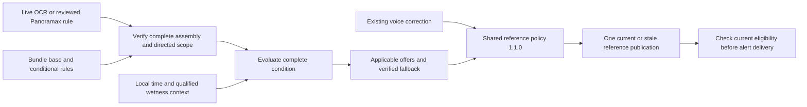

# Conditional speed limits from OCR: application specification

Date: 23 October 2026. Status: application contract. The historical gap
assessment below describes the implementation on that date. The 24 October
completion adds native live assembly evidence, conditional activation and clock
reevaluation. See the [current implementation and verification
record](CONDITIONAL_RESTRICTIONS_2026-10-24.md) for its tested scope and device
installation status, and the [23 October continuation
record](V1_5_IMPLEMENTATION_CONTINUATION_2026-10-23.md) for the earlier state.
Applies equally to iPhone and Android; iPhone remains the implementation reference.

The app must evaluate a speed sign together with its complete supplementary
restriction before using it for overspeed warnings or penalty estimates. A
verified active condition permits the sign to participate in the existing
speed-reference selection. A verified inactive condition removes that rule from
consideration. An unknown condition cannot establish a current speed limit.
An independent, still-valid reference can continue to produce warnings;
otherwise the app shows uncertainty and withholds limit-dependent warnings.

This specifies an external condition evaluator and its integration with the
existing shared reference policy. It does not authorize changes to policy
1.1.0, its approval lock, source priority, expiry, or interpreter semantics.

## 1. Evidence and the current gap

The public Panoramax API was read on 23 October 2026, Europe/Berlin. A query for
`youspeed|ocr_source=plate-ocr-v1`, limited to 100 items, returned 91 items with
94 plate annotations and no next link. There were 50 `candidate`, 30
`informational`, and 14 `unparsed` annotations; all 94 carried
`youspeed|evaluation_enabled=false`. These are snapshot annotation counts, not
unique physical signs, recognition accuracy, or a complete inventory of every
OCR pipeline. General `sign-text-v1` results are outside this count.

The [evidence extract](CONDITIONAL_SPEED_LIMITS_OCR_2026-10-23.evidence.json)
retains the query, retrieval time, response hash and nine representative records
with parent IDs, geometry, raw text and parser provenance. Source-image review
was not performed for this specification. The following are observed server
interpretations, not independently verified roadside rules:

| Observed plate under its classified parent | Server result | Required handling after verification |
|---|---|---|
| [30; `Mo-Fr / 630-1730h`](https://panoramax.youspeed.de/api/collections/71750bfd-17df-4a62-b11a-ee5e35c8ce36/items/8e0020b0-b22b-490f-a287-cbcf4ad0b6c6) | `30 @ (Mo-Fr 06:30-17:30)` | Evaluate weekdays and minute-accurate local time together. |
| [30; `22-6h`](https://panoramax.youspeed.de/api/collections/b23c42f0-217d-4a50-96ad-0ed96ab0dbab/items/efbc0fce-e8f0-4abe-b336-2f2b38a38aae) | `30 @ (22:00-06:00)` | Evaluate a window crossing midnight. |
| [30; `Lärmschutz / 22-6h`](https://panoramax.youspeed.de/api/collections/994aa2f1-336f-4c60-8309-771124138e2f/items/03e92c17-732a-4323-8e09-5c5db4de235e) | Same overnight candidate | Retain the explanation and the time condition. |
| [120; `bei / Nässe`](https://panoramax.youspeed.de/api/collections/4ec8407b-d2f8-4780-be2a-9e2836c1201a/items/009e89e8-6a28-460b-a573-23ec4ecc2257) | `120 @ (wet)` | Evaluate wet road surface, not merely current rainfall. |
| [30; `Mo-Fr / 630-1730h / Kindergarten`](https://panoramax.youspeed.de/api/collections/59260499-9b13-4bdc-abfe-58122ea6d7c8/items/66f4c467-bdd2-4c10-81f6-d6bd40dd7395) | `unparsed` | Review the complete assembly; do not silently extract only its clock. |
| [30; `Lärmschutz`](https://panoramax.youspeed.de/api/collections/efd72ea4-79a6-4db9-90f3-a370daa0b585/items/18e7e6be-9bdc-476c-92bf-1efc6466d4c9) | `informational` | The word alone does not establish a night-only schedule. |
| [80; `↑5km↑ / Unfall- / strecke`](https://panoramax.youspeed.de/api/collections/47a66010-716a-42f5-b63f-1c805e191ce5/items/73f0e93a-49f6-4189-9fd7-39b47bd183a9) | `informational` | A possible spatial extent must not be discarded as explanatory text. |

The extract also includes truncated `Lärmschu` and `3,5 t / RAPPEL`, which must
not become unconditional limits through partial parsing.

Implementation at the 23 October assessment:

- Both apps collect raw supplementary OCR and an optional start/end-minute
  pair, then format, display and speak the text. The collection DTO is explicitly
  not a road-rule evaluator. The minute pair carries no weekday, time zone,
  wetness, logical structure, completeness or approval information.
- Initial OCR can defer authoritative publication, but later clearer-view OCR
  updates auxiliary evidence only. It currently cannot correct speed authority.
- Existing sign models have `none/resolving/resolved/unresolved` condition states
  and restriction kinds, but the structural resolver treats conditional starts
  as review-only. A condition being parsed is distinct from it being true now.
- Both `SpeedReferenceRuntime` implementations accept evaluated applicability,
  but their normal controller calls omit it and receive an unconditional default.
  The shared policy already admits only `applicable` inputs for the current
  applicability revision. Sending an unresolved offer alone does not necessarily
  withdraw authority admitted earlier.

See [supplementary OCR](TSR_SUPPLEMENTARY_OCR_2026-10-16.md),
[reference model](speed-limit-reference/MODEL.md), and the
[optional inventory runtime](../mapdata/spec/traffic_sign_runtime_v1.md).

## 2. Product invariants

1. Keep recognition, rule interpretation, current applicability, and warning
   eligibility separate. A recognized `30` is not itself a verified applicable
   30 km/h rule.
2. Evaluate the complete sign assembly for the actual directed road/lane. Never
   attach a plate by text similarity, nearby GPS or capture time alone.
3. Use three applicability outcomes: `applicable`, `inapplicable`, `unresolved`.
   Unreadable, unsupported, stale and missing-context conditions remain unknown.
   OCR `no_text` or failure does not mean that a sign is unconditional.
4. An inactive or unknown conditional limit must never be reintroduced through
   immediate camera overrides, passage resolution, a flattened bundle value,
   cached presentation, speech, or local observation storage.
5. Displayed authoritative value, overspeed calculation and penalty baseline
   come from the same reference publication. Every queued warning is checked
   again before delivery.
6. Preserve existing voice-correction priority and expiry. Conditional parsing
   does not silently rewrite or cancel an explicit driver correction.
7. Re-evaluation never renews ordinary camera evidence. Existing limits of
   300 seconds or 5 km, context invalidation, dismissal and independently
   verified enclosure semantics remain in force.
8. A supplementary restriction becoming inactive is not a speed-end sign, a
   road boundary, proof of an unlimited road, or permission to invent a default.

## 3. Rule and context contracts

Add a versioned interpreted-rule record alongside the immutable OCR annotation.
Do not change the meaning of the collection DTO or rely on the existing
`parsed_time_window` field as an authoritative rule.

| Record | Required content |
|---|---|
| Identity and provenance | Stable rule/physical-passage ID; parent and plate IDs; exact source frame/item; raw text; boxes; capture time; OCR engine/pipeline/evidence hashes; parser and interpretation revision. |
| Verification | `candidate / verified / rejected`; verifier/version and evidence; primary speed agreement; assembly association and completeness; supported country/template. Server `candidate` is not `verified`. |
| Scope | Country/jurisdiction, directed road/path and lane applicability, start/end stations or independently verified enclosure, bundle/source revision and match confidence. Unknown sign location is distinct from camera location. |
| Rule | Typed limit and unit; condition expression; preserved informational clauses; unresolved residual tokens/plates; effective dates and explicit supersession/end relationships when known. |
| Evaluation | `applicable / inapplicable / unresolved`; reason codes and per-leaf results; session, scope generation, applicability revision, interpretation revision, evaluated-at time and next evaluation deadline. |
| Ordinary evidence origin | Original monotonic observation time and travelled distance, fixed across parsing retries, source refreshes and condition changes. |

Condition expressions support `all`, `any` and typed predicates. The initial
predicate set is `local_schedule` and `road_surface_wet`. Unknown leaf kinds
must remain unresolved. Informational reasons such as verified `Lärmschutz`
are separate from predicates. Spatial extent belongs to scope; vehicle/weight
clauses remain explicit unsupported predicates until implemented.

Example **proposed interpreted rule**, valid only after verification:

```json
{
  "schema_version": 1,
  "rule_id": "reviewed-school-30",
  "interpretation_revision": 1,
  "verification": "verified",
  "limit": {"kind": "numeric", "kmh": 30},
  "condition": {
    "kind": "local_schedule",
    "weekdays": [1, 2, 3, 4, 5],
    "windows": [{"start_minute": 390, "end_minute": 1050}],
    "weekday_anchor": "window_start_date"
  },
  "informational_text": ["Kindergarten"]
}
```

This example omits provenance and scope for readability; it is not a complete
wire schema and does not promote the current unparsed server record. ISO
weekdays are Monday=1 through Sunday=7. New contracts must be pinned and tested
in both clients and the bundle builder before deployment.

The evaluation context contains:

- UTC instant, clock trust/uncertainty, monotonic drive time and distance;
- geographic IANA time zone and its source, jurisdiction/holiday-calendar
  availability, fresh directed road/lane context;
- `road_wetness = wet / dry / unknown`, with source, observed time,
  validity deadline, spatial validity and quality;
- drive/session identity, scope generation and applicability revision.

Raw OCR remains unchanged. Parser normalization may normalize whitespace,
Unicode dashes and supported compact clocks such as `630-1730h`; it must not
guess missing digits, invent diacritics, or discard a conflicting clause.

## 4. Admission and parsing

Two producers use the same logical evaluator:

1. **Reviewed Panoramax rules in an offline bundle.** Server OCR supplies
   candidates for review and source inspection. Verify the sign/plate grouping,
   primary value, all clauses and directed scope before exporting a runtime rule.
   Source capture time describes evidence age; applicability uses the current
   driving time. Revalidate/remove superseded signs through normal bundle upkeep.
2. **Live camera rules.** Preserve current detection, physical tracking and lane
   admission. A separate condition interpretation update may change the verdict
   for that same passage without replaying detection, passage counts or capture.
   Initially use only reviewed parser templates with a complete visible assembly
   and two distinct accepted source frames agreeing on the full interpretation.
   Interpolation passes over one frame are not independent confirmation.

For either path, `evaluation_enabled=false` remains a prohibition on directly
using that annotation as an executable rule. A separately reviewed export must
retain the source flag and record its own explicit runtime eligibility. Do not
flip the flag or treat a source pipeline name as implicit approval.

The initial supported templates are Germany numeric maximum signs with complete
daily clock windows, explicit weekday plus clock windows, and `bei Nässe`.
Verified explanatory text may accompany a supported condition. Recognize exact
informational templates separately: a complete `Lärmschutz` or `Schule` plate
alone does not provide a schedule or evidence of school opening hours.

An unknown word, cropped line, second unread plate, exception (`frei`, `außer`),
unresolved distance/direction, vehicle qualifier or conflicting read prevents
promotion of the entire assembly. A known false clock must not authorize action
on a rule whose overall meaning is still unverified. Do not repair truncated
`Lärmschu` into an informational-only interpretation.

For multiple windows within one reviewed schedule, take their union. Combine
different predicates with AND/OR only where the complete text/layout and
country template establish that relationship. Do not infer AND from vertical
stacking alone. `30 at night OR when wet` differs from `30 at night AND wet`.
No embedded scripts, arbitrary expressions or remotely supplied evaluator code.

`conditionState=resolved` means interpretation is complete. The current truth
still comes from the separate applicability verdict. Existing `none` is allowed
only for positively verified absence of an applicability restriction; it is not
the fallback for OCR timeout, missing pixels or unsupported clauses.

## 5. Time evaluation

Use the time zone at the rule's road location, not the phone's selected time
zone, UI language or the retained model pack. Germany uses `Europe/Berlin`;
other supported regions require a geographic zone resolver. Near an unresolved
zone border, or without trusted time/zone, return `unresolved`.

The proposed schedule convention is start-inclusive/end-exclusive, `[start,end)`:

- `06:30–17:30`: active at 06:30:00, inactive at 17:30:00.
- `22:00–06:00`: active when local time is at least 22:00 or below 06:00.
- Explicit `Mo–Fr` checks ISO weekdays; do not add holiday or school-vacation
  exceptions that are not printed.
- For weekday windows crossing midnight, select the window's start date. Under
  that reviewed template, Friday 22:00 extends to Saturday 06:00; Monday 05:00
  belongs to Sunday's window. Do not independently test the current weekday.
- `start=end` is ambiguous and unresolved, not implicitly 24 hours. Support
  `00:00–24:00` only through an explicit full-day representation; do not squeeze
  1440 into the current collection DTO's 0–1439-minute fields.

These are proposed executable template semantics. Verify country-specific
wording, especially overnight weekday anchoring and exceptions, before enabling
the corresponding template. This spec does not claim universal legal semantics
for a free-form schedule string.

Evaluate an actual UTC instant against local civil time. During the autumn
clock repeat, both occurrences of the same local minute have the same schedule
truth. During the spring gap, nonexistent minutes are never observed; determine
the next truth change from real instants and zone transitions, not by adding a
fixed 24 hours. At a clock uncertainty interval crossing an applicability
boundary, return `unresolved` until every possible instant yields the same truth.

Compute the next boundary and re-evaluate on that boundary, midnight, time-zone
or jurisdiction change, significant clock correction, resume, and the existing
one-second drive tick. A stopped vehicle must update without a new GPS fix or
camera frame. Ordinary evidence can still expire before the next boundary.

Recognize but withhold unsupported holiday (`Feiertage`), `werktags`, school-day,
season/date and exception expressions until a reviewed jurisdiction-specific
calendar/template exists. Do not guess `werktags = Mo–Fr` or infer opening hours
from `Kindergarten`.

## 6. Weather evaluation

The first supported weather predicate is **wet road surface**. German StVO
Anlage 2, entry 49.1, ties the Zusatzzeichen under Zeichen 274 to a wet
carriageway. Consequently current rainfall and road wetness must be distinct
context fields. See the [official wording](https://www.gesetze-im-internet.de/stvo_2013/anlage_2.html).

| Wetness context | `road_surface_wet` result | Consequence for that rule |
|---|---|---|
| Qualified, fresh `wet` | true | May become applicable if every other condition is true. |
| Qualified, fresh `dry` | false | Inapplicable if its interpretation is otherwise complete. |
| Missing, stale, conflicting or unqualified evidence | unknown | Unresolved, unless an already verified Boolean expression has another decisive operand. |

Proposed first-release default: `unknown` on both platforms. The inspected
speed-reference/OCR path supplies no qualified wetness input, and this spec
does not assume access to wipers, a rain sensor or a validated road-surface
model. Offline operation, denied network permission and weather-service failure
therefore remain deterministic. The wet restriction can be recognized and
shown, but cannot supply a definite overspeed warning without qualified context.
This trades some missed conditional warnings for fewer incorrect definite ones.

A later weather-context adapter may supply measured road wetness, validated
vehicle evidence, or an explicit driver report. Each source needs documented
quality, time/distance validity and conflict rules. Rain forecasts, nearby
station observations, rain probability, temperature, wiper inactivity and “rain
has stopped” alone must not establish `dry`; rain/wiper activity alone must not
automatically establish wetness of the relevant carriageway. In particular,
do not clear a wet restriction as soon as precipitation ends.

Expire qualified input to `unknown`; do not retain it for an entire trip by
default. If sources disagree without a validated precedence rule, use `unknown`.
Provider-specific validity bounds and any new wet/dry driver control require a
separate concrete design before enabling that provider. No new permissions,
weather downloads or driver interactions are needed for the first-release
unknown behavior. Snow, ice, fog, visibility and rain-specific predicates must
remain distinct and unsupported until their own evaluator is implemented.

For a verified Boolean expression, use three-valued logic:

| Expression | True | False | Unknown |
|---|---|---|---|
| `all(operands)` | Every operand true | At least one operand false | Otherwise |
| `any(operands)` | At least one operand true | Every operand false | Otherwise |

Unknown assembly structure/meaning fails admission before this truth table.
For example, a verified `night AND wet` rule is inactive at noon even with
unknown wetness; `night OR wet` at noon remains unresolved.

## 7. Choosing the reference and suppressing warnings

Evaluate both camera and bundle producers before passing their offers to the
existing reference machine. Keep its current voice > camera > bundle priority.



| Rule verdict | Authoritative offer | Driver-facing treatment |
|---|---|---|
| Applicable | Offer the verified rule and evaluated envelope. | Normal current reference and existing alert thresholds, if selected. |
| Inapplicable | No authority from this rule. | A still-valid independent reference may be selected; show the restriction as inactive when useful. |
| Unresolved or still resolving | No authority from this rule. | Preserve its observed text with uncertainty; use a proven compatible fallback or no numeric warning baseline. |

“Fallback” requires proof of current scope and applicability, not simply the
previous number or a higher number. Resolve the road's explicit base rule,
verified enclosure/default and conditional alternatives as one rule set before
offering its selected bundle value. An inactive conditional 30 does not imply
50, 100, 130 or unlimited.

An independent fallback is eligible only when its use remains valid across the
unresolved alternatives. For an exact current reference, all reachable selected
values must agree, or an independently authoritative source must remain
unaffected by those alternatives. A base 50 versus a possible conditional 30
does not establish an exact current 50; a possible conditional 120 replacing
100 likewise cannot establish a definite current 100. If the relationship,
replacement order or relevant alternatives are unknown, withhold the fallback.
Do not choose the lowest or highest possible number to resolve a conflict.
The shared model has one exact current value; a separate conservative alert
ceiling is outside this design. See the OSM mapping companion for ordered rules
and typed unlimited alternatives.

Prevent an important duplicate-source failure: if the same night-only 30 is
also flattened to an unconditional 30 in OSM/bundle data, rejecting the camera
30 and immediately warning from the map 30 does not solve the problem. Use
verified directed scope and provenance to invalidate/quarantine that affected
bundle offer until it has been reconciled. Nearby text or equal numeric values
alone are insufficient to identify the same rule. Re-querying the same
unreconciled row cannot restore its authority.

For a new candidate, reject an irrelevant side-road sign without disturbing
the current road's authority. For a verified new assembly that may replace the
currently active rule but cannot yet be evaluated, invalidate affected prior
authority and do not assume it still holds. Independently verified enclosures
can be re-offered only if the producer proves they remain applicable; an old
ordinary camera claim cannot be resurrected from storage.

Publish the selected reference and its applicability revision together. Clear
pending limit-change/overspeed speech, tones, haptics, overspeed colouring and
penalty estimates derived from a withdrawn reference. Before playing an alert,
verify that its evidence ID, value, session, scope generation and applicability
revision still match the current warning-eligible reference. This includes
warnings queued just before 06:00 or before a late OCR correction.

LAST_KNOWN remains visibly stale and has no warning/penalty baseline. Unknown
is not rendered as zero or unlimited. Existing tolerances, country penalty
rules and notification preferences apply only after reference eligibility.
Weather recognition does not introduce a separate generic hazard alarm.

## 8. Lifecycle and existing policy integration

Add a serialized condition coordinator in each driving controller. It owns the
interpreted evidence store and context snapshot; it does not modify the state
machine. Reserve an ordinary passage's original monotonic time/distance at its
existing observation/activation boundary, before waiting for condition reads.
The runtime adapter currently records origins on its first camera offer; ensure
that a delayed first offer uses the reserved original origin through an explicit
adapter input or an equivalent tested registration path, not the later clock.

| Trigger | Required transition in the producer/coordinator |
|---|---|
| Confirmed primary; complete condition not yet known | Display observed sign if admitted; hold current authority from that candidate. Preserve an independent reference only while its continuing validity is established. |
| OCR deadline, missing pixels/plate completeness, failure | End the pending work as unresolved; never promote automatically to unconditional. Keep existing bounded OCR attempts and thermal handling. |
| Two accepted reads agree on complete supported interpretation | Evaluate against the current context; offer only an applicable rule. |
| Late OCR reveals a condition on an already admitted sign | Retract affected immediate/resolver offers, advance applicability revision, and re-evaluate eligible sources before the next publication. |
| Conflicting later read | Retain raw reads; return the interpretation to unresolved. A lower-quality empty read alone does not overwrite an established complete read. |
| Time boundary, qualified weather change/expiry, zone/clock change | Advance the context revision once, then re-evaluate retained current-scope evidence. |
| Dismissal, road/country/bundle change, drive reset | Apply existing lifecycle rules; reject old callbacks and invalidate relevant condition context. |

Do not expand the existing selected-sign-group OCR scope as part of this work.
Use existing completion/defer signals as pending-work bounds. If a candidate
cannot become authoritative without extra pixels that never arrive, continue
with unresolved behavior rather than introducing an indefinite loading state.
No new confidence number is claimed to guarantee OCR accuracy; calibrate the
proposed two-frame agreement rule against held-out physical signs.
Preserve existing daylight/camera enablement gates: evaluating a stored bundle
schedule at night does not enable night-time camera recognition or revive a
camera claim withdrawn by those gates.

Re-evaluation sequence, within one controller publication transaction:

```text
snapshot = current session + directed scope + context + interpreted evidence
nextRevision = currentApplicabilityRevision + 1
compute verdicts for eligible retained sources using nextRevision
discard computation if its session/scope/interpretation snapshot is outdated
send applicability_context_changed(nextRevision)
re-offer verified bundle/enclosing/camera evidence with evaluated envelopes
  and unchanged physical IDs and original ordinary observation origins
publish the machine's selected reference once
cancel queued alerts that no longer match; log the evaluation and selection
```

`applicability_context_changed` clears camera, enclosing-camera and bundle
authority under the existing policy. Thus re-offer every still-valid source
needed for that revision, not only the sign whose condition changed. Preserve
active voice corrections. The producer must not resubmit evidence previously
suppressed by voice, dismissed, expired or invalidated by a scope boundary.

Serialize asynchronous completions with GPS, timers and UI publication. Check
the revision again immediately before committing. A newer condition result
cannot be overwritten by a delayed old result. The one-shot withdrawal API is
not a substitute for repeated context revisions. Do not use confirmed-boundary
events to simulate a clock/weather change.

Both current controller paths contain immediate and passage-based camera
offers. Both must carry an explicit evaluated envelope. Add a dedicated
condition-update delivery path: today's `supplementaryOCROnly` early return
must still preserve collection/display but also notify the condition
coordinator when the matching interpretation changes. Do not replay primary
fusion, passages, capture triggers, sign counts or original speed speech.

The current structural resolver's unconditional-only guard must be extended at
the producer layer to consume a verified applicable interpretation, while
retaining its other scope/structural checks. Merely changing the final audio
guard or marking a conditional detection `none` is insufficient.

## 9. Offline data delivery and compatibility

The [Baden-Württemberg OSM inventory and mapping specification](CONDITIONAL_MAXSPEED_BW_MAPPING_SPEC.md)
extends this section with source-pinned counts, all observed conditional key
forms, complete condition-family mappings, ordered OSM interpretation, concrete
core bundle tables, delta requirements and rollout fixtures. Its
[inventory](CONDITIONAL_MAXSPEED_BW_2026-10-23.inventory.json) covers 4,089
conditional-namespace way/tag occurrences on 4,069 ways, including eight
reason-metadata entries that do not supply a speed. The condition capability
must be core road data, independent of the optional sign-inventory overlay.

Propose a separate versioned bundle capability, `conditional_speed_rules_v1`,
with indexed directed rule intervals, base-rule references, condition records,
verification/provenance, and explicit conflicts/supersession. Final SQL/JSON
schemas are implementation deliverables; do not silently repurpose the current
inventory v1 `lane_scope` or numeric speed columns.

The builder must retain applicable OSM conditional/directional tags and
reviewed Panoramax interpretations without flattening them into an unconditional
speed. Feed both through the same on-device evaluator. Existing inventory
rules already reject some conditional scopes; retaining source tags is not
proof that the client evaluates them.

Unreviewed OCR, incomplete association, unsupported conditions and ambiguous
lane scope cannot be exported as active scalar limits. Separate source capture
location from a verified sign station. Carry source age and supersession data;
an old photograph does not prove that the sign remains installed.

Clients negotiate capability/schema/runtime compatibility through the existing
bundle manifest/catalog mechanisms. Ignoring an optional table is safe only
when legacy scalar values remain independently valid. Where ignoring conditions
would produce an incorrect unconditional limit, require the compatible minimum
runtime or exclude/quarantine the affected legacy offer; do not advertise such
a bundle as transparently compatible with older apps.

All condition evaluation works offline. No synchronous Panoramax lookup during
a drive is required. Downloads retain existing consent and network gates on
both platforms. Bundles contain declarative road rules, never replacement
reference-policy bytes, thresholds, priorities or executable evaluator code.

## 10. Presentation and diagnostics

Keep the primary authoritative speed presentation and the existing matching
supplementary label. Use concise localized condition states without implying
that an inactive sign permits any particular higher speed:

- Active: `30 · Mo–Fr 06:30–17:30`.
- Inactive: observed restriction `30 · 22–06 h · currently inactive`; show the
  independently selected current reference in the normal primary position.
- Unknown wetness: `120 when wet · road condition unknown` as observed/advisory
  evidence, with no authoritative 120 circle or definite overspeed claim from it.
- Unknown interpretation: `Restriction not confirmed`, retaining readable OCR
  text when available. If no current reference exists, show unknown or clearly
  stale memory through existing presentation conventions.

Do not announce “limit 30” unconditionally while its restriction is pending.
Existing sign speech may read the complete observed conditional sign in the
selected feedback mode, provided it is clearly qualified and deduplicated.
Activation can produce existing limit-change feedback once; deactivation or
unknown wetness must not produce “you may now drive faster”. Re-evaluation
must not repeatedly announce the same physical sign.

Use text/state semantics as well as colour and accessible labels. Any sign
pictograms use the shared official assets; numeric circles retain their existing
schematic treatment. Add no in-app state-machine viewer or evaluator settings.

Diagnostics should record rule and source IDs, interpretation/parser revision,
per-leaf result, final verdict/reason, context revision, local zone/time and clock
trust, wetness source/age/validity, retained evidence origin, chosen reference,
and alert suppressed/cancelled reason. Suggested stable reasons include
`outside_schedule`, `schedule_active`, `clock_untrusted`, `timezone_unknown`,
`surface_dry`, `wetness_unknown`, `weather_stale`, `unsupported_clause`,
`assembly_incomplete`, `ocr_conflict`, `source_not_verified`,
`base_rule_conflict`, and `stale_evaluation`. Keep raw OCR in its existing
consented evidence path; additional evaluations do not imply additional uploads.

## 11. Acceptance scenarios

All scenarios require the same outcomes in Swift and Kotlin. Rule truth is
tested separately from existing reference eligibility and alert thresholds.
Unless stated otherwise, inputs have verified interpretation/scope, trusted
local time and unexpired evidence. Fallback speeds below are explicit test
fixtures, not values inferred from the photographed signs.

| Case | Expected result |
|---|---|
| Weekday 30, `Mo–Fr 06:30–17:30`, Monday 06:29:59 / 06:30 / 17:30 | Inactive / active / inactive. |
| Same rule Saturday noon | Inactive; independent verified 50 may remain current. No warning solely for exceeding 30. |
| Daily 30, `22–06 h`, 21:59:59 / 22:00 / 00:30 / 06:00 | Inactive / active / active / inactive. |
| Reviewed `Mo–Fr 22–06 h`, Saturday 05:00 / Monday 05:00 | Active / inactive under the start-date-anchored template. |
| Autumn repeated 02:30; spring skipped hour | Truth follows actual local civil time; next transition is a real instant. |
| Device set to another zone; offline operation | Use geographic road zone and trusted clock; missing zone returns unresolved. |
| Clock uncertainty straddles 17:30 | Unresolved until the uncertainty no longer changes the verdict. |
| `bei Nässe`: qualified wet / dry / unknown / expired wet input | Applicable / inapplicable / unresolved / unresolved. |
| Rain ends while a qualified wet observation remains valid | No automatic transition to dry. |
| Forecast says dry, no qualified surface evidence | Unresolved; forecast cannot enable a dry-road fallback. |
| `night AND wet` / `night OR wet`, daytime and wetness unknown | Inactive / unresolved, assuming expression structure verified. |
| `Lärmschutz` alone, complete verified plate | No inferred time restriction; normal rule eligibility remains required. |
| Weekday/time/Kindergarten plate | Current server record stays unparsed until reviewed; complete approved template preserves the schedule and explanation. |
| Truncated `Lärmschu`, unread lower plate, `3,5 t`, or `150m` | No partial promotion to an unconditional speed; unresolved until relevant scope/clauses supported. |
| `no_text`, OCR failure, critical-heat defer or tiny crop | No unconditional admission on timeout; independent valid sources may continue. |
| New irrelevant exit-lane conditional sign | No effect on the current carriageway's verified reference. |
| Confirmed same-road replacement, condition unresolved | Retract affected previous authority; retain only proven compatible sources. |
| Conditional rule inactive, no valid fallback | No current numeric warning baseline; no invented unlimited or default speed. |
| Conditional map 30 duplicates inactive camera 30 | Quarantined/reconciled map offer cannot reintroduce the same warning. |
| Possible conditional 120 replacing 100, wetness unknown | No definite warning against 100 without proof it remains valid. |
| Late accepted OCR changes already admitted 30 to inactive/unknown | Retract current 30 before next publication; cancel its queued speech/alerts and penalty estimate. |
| Time boundary while stopped, without new GPS/frame | Re-evaluate on time; cancel obsolete queued alerts before delivery. |
| Repeated reads, formatting, context revisions, UI refreshes | No new physical passage and no renewed ordinary evidence lifetime. |
| Clock/weather change after ordinary 300 s or 5 km expiry | Expired camera sign stays expired; only other eligible sources participate. |
| Active voice correction during context revision | Existing voice priority and original lifetime preserved. No resurrection of voice-suppressed camera evidence. |
| Old OCR callback after dismissal, reset, bundle/scope change or new revision | Reject; no authority restoration, duplicate collection or stale alert. |
| Conflicting eligible rules with no established ordering | Unresolved; do not select the minimum or maximum by convenience. |
| Old client receiving a condition-dependent bundle | Compatibility gate prevents silent unconditional interpretation. |

## 12. Implementation slices and release criteria

1. **Contracts and fixtures:** finalize interpreted-rule, context and bundle
   schemas; inspect the source images and verify grouping/scope; build shared
   positive, negative and ambiguous fixtures, including the examples above.
   Keep annotation/attempt counts separate from physical-sign counts.
2. **Pure evaluator:** implement the same parser templates and three-valued
   schedule/wetness evaluator in Swift and Kotlin against one shared fixture
   corpus. Cover time-zone/DST/clock uncertainty and unsupported residual text.
   Keep weather unknown unless a separately qualified source is present.
3. **iPhone controller integration:** implement condition updates, origin
   preservation, explicit envelopes, serialized re-evaluation, fallback
   quarantine, and atomic presentation/alert cancellation. Cover both immediate
   and passage/bundle paths with controller tests.
4. **Android parity:** implement the same inputs, states, defaults, presentation,
   speech, lifecycle and diagnostics. Test the actual controller, not only the
   evaluator and policy interpreter.
5. **Bundle production:** review/export directed conditional rules, retain
   complete conditions, prove base-rule relationships, and validate compatibility
   and source supersession. Server candidate status alone never enables rules.
6. **Shadow validation then enablement:** record proposed decisions without
   changing authority; replay held-out physical signs and boundary cases; verify
   that sign recognition and condition eligibility are measured separately.
   Enable enforcement only after both controller suites and device acceptance
   pass. Remain explicit about wet-condition warnings unavailable with unknown
   surface state.

Release criteria: shared scenario parity; no known definite alert based solely
on an inactive/unresolved rule; no discarded unknown clause; no duplicate-source
reintroduction; unchanged ordinary evidence origins and shared-policy checks;
offline/permission/failure behavior verified; queued alert cancellation proven.
When device deployment is requested, exercise both attached apps, including
inactive time, late OCR, stopped time boundary, unknown wetness and reset cases.
Use isolated tests; do not claim real-drive accuracy from synthetic replays.

The normal reference-policy conformance suite must remain unchanged and pass.
If implementation discovers a need to alter selection, expiry, outputs or
interpreter semantics, record that as a separate owner-commanded policy change
under [policy governance](../shared/speed-limit-reference/AGENTS.md).

Decisions still needed before broader enablement: a qualified wetness provider
and its validity limits, any driver wet/dry interaction, non-DE country/calendar
templates, and support for spatial/vehicle/exception clauses. Their absence
does not block deterministic unresolved handling or the reviewed simple German
time-window implementation.

## Source and integration references

- [Panoramax public API](https://panoramax.youspeed.de/api/) and the linked
  per-item records in section 1; captured subset in the evidence extract.
- [StVO Anlage 2](https://www.gesetze-im-internet.de/stvo_2013/anlage_2.html),
  entry 49.1: wet-carriageway condition. This supports the wetness distinction,
  not a proposed sensor threshold or fallback rule.
- [Official sign catalogue](https://www.verwaltungsvorschriften-im-internet.de/BMVBW-S32-0001-KF10-BS-A008.htm):
  distinct time, wetness and other supplementary-sign categories. Country-specific
  legal interpretation is not delegated to generic OCR string matching.
- iPhone: [OCR annotation](../iphone/SpeedConsumerApp/SupplementaryOCRAnnotation.swift),
  [recognition/runtime](../iphone/SpeedConsumerApp/TrafficSignRuntime.swift),
  [sign models](../iphone/SpeedConsumerApp/TrafficSignRecognition.swift),
  [passage and structural resolver](../iphone/SpeedConsumerApp/TrafficSignPassageEvaluation.swift),
  [controller](../iphone/SpeedConsumerApp/DriveSessionViewModel.swift),
  [reference adapter](../iphone/SpeedConsumerApp/SpeedReferenceRuntime.swift).
- Android: [OCR annotation](../android/app/src/main/java/de/youspeed/android/alpha/SupplementaryOCRAnnotation.kt),
  [controller](../android/app/src/main/java/de/youspeed/android/alpha/ConsumerSessionController.kt),
  [reference adapter](../android/app/src/main/java/de/youspeed/android/alpha/SpeedReferenceRuntime.kt).
- Bundle production: [traffic-sign runtime builder](../scripts/map/build_traffic_sign_runtime.py)
  and [runtime capability contract](../mapdata/spec/traffic_sign_runtime_v1.md).
