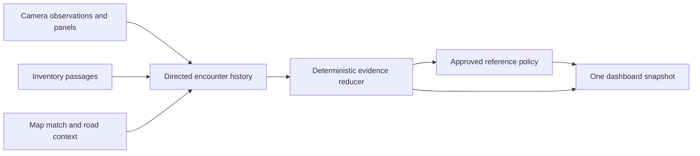

# iPhone evidence ordering and bundle redesign — 26 October 2026

The new attached-iPhone logs confirm that accepted camera evidence can be
cleared by repeated map-derived town transitions. Physical boundaries can also
be processed twice. Ahead presentation depends on these intermediate states,
direction admission and conservative topology, which explains its inconsistent
appearance. This needs a coordinated evidence/presentation repair, rather than
another global priority or timeout adjustment.

The bundle-size complaint is independently confirmed. The active
Baden-Württemberg database is **3,185,627,136 bytes** unpacked and
**989,583,784 bytes** compressed. Five retained BW database versions total
**11,311,022,080 logical bytes** on the phone. These are file lengths, not a
measurement of physically allocated storage.

This document records findings and a proposed implementation. Application
behavior, bundles, the approved reference policy and the attached device were
not modified. Existing unrelated Android working-tree changes were preserved.

The follow-up [OSM storage research](OSM_RUNTIME_STORAGE_RESEARCH_2026-10-26.md)
compares Ascend Maps, GeoDesk, routing graphs and vector-tile formats, and adds
full-column lossless geometry measurements for a possible binary runtime pack.

## Evidence and scope

Fresh copies from `de.youspeed.SpeedConsumer` include the session named
`20261026_104119`, its complete match and TSR files, the active-bundle pointer,
and the application-support file inventory. A fresh application inventory
confirms **version 1.5 / build 10072**. The two log copies match the
inventoried lengths: **14,043,094** and **177,381,680 bytes**. Local SHA-256
receipts are retained with the evidence. The match copy contains **2,920 valid
records**, covering **11:41:22–16:04:25 CET**; driving activity resumes around
**15:28** after the long stationary interval.

All example times below are **Europe/Berlin, CET, UTC+1**. The raw files use
UTC. Some diagnostics stamp the originating GPS fix, others the callback time;
their timestamps alone cannot establish callback order. Original file order
was retained for the examples.

The session's reference identity is policy **1.2.0**, hash
`35d1a9b68d5e3abc6b5e200ec9b1a110bcfe5fea80b5de3639344e278e9037ce`.
Both its diagnostics and the copied active pointer identify the
`2026-10-23-v1.5-journal-conditional` bundle, DB hash
`e973d279de2803b13037b9e87132be72f28a22d8f9c9bbef79d73093772b1849`.
The earlier persistent/in-memory bundle discrepancy is not reproduced here.

This is an iPhone log investigation with Android source-parity inspection.
No new drive, screen inspection, Android log collection, or full controller
replay was performed. Logs establish application decisions, not the truth of
every recognized sign or proof that every transient state reached the screen.

## Confirmed failure mechanisms

### Settlement knowledge is being treated as another town passage

There are **21 town invalidation records: 19 entry and two exit**, at **19
distinct timestamp/reason pairs**. These are not 21 independently verified
physical town boundaries.

The Swift `TrafficSignBundleContextTracker` retains high-confidence settlement
confirmation for eight seconds/160 metres. After that memory is discarded,
another high-confidence `insideCity=true` observation emits `enteredCity`.
Residential-road and `zone:traffic` inference can produce that observation;
neither proves that a physical town sign has just been passed. Additional
controller resets can also erase confirmation.

`invalidateTrafficSignStateForBundledCityContextTransition` turns the result
into a full reference boundary. It advances the generation and clears the
immediate override, passage resolver, traversal and current recognition state.
Consequently a change in map knowledge can destroy stronger already accepted
visual evidence.

| Local time | Recorded behavior |
| --- | --- |
| 15:36:17–23 | Camera 30 is admitted, and a numeric passage is applied at 15:36:20. At 15:36:23, `settlement:zone_traffic:high` creates a city-entry boundary and the reference returns to bundle 50. |
| 15:40:40–43 | Map fixes have missing direction/preview context, then road-departure and city-entry boundaries occur in the same lookup. The reference becomes bundle 50; a 30 preview appears only about 38 m ahead. |
| 15:41:47, 15:41:55, 15:42:08, 15:42:23 | Short residential-way matches repeatedly generate entry invalidations among surrounding `settlement:missing:unknown` results. |

An isolated native Swift replay extracted the **unchanged tracker** and fed all
2,920 published lookup observations through it. It reproduced **nine entries
and one exit**, including the 15:36:23 entry. It excludes controller resets and
direct inventory/camera boundaries, and therefore does not explain all 21
records. It demonstrates that re-entry after lost settlement confirmation is
intrinsic to the current tracker.

Relevant code:
[tracker](../iphone/SpeedConsumerApp/TrafficSignPassageEvaluation.swift),
[iPhone controller](../iphone/SpeedConsumerApp/DriveSessionViewModel.swift),
[Android tracker](../android/app/src/main/java/de/youspeed/android/alpha/TrafficSignCityEntryTracker.kt).

### One inventory boundary can advance the reference twice

At **15:56:44**, the inventory town exit produces two `T08 city_exit`
transitions, generations **32 → 33**, for the same fix. At **15:59:02**, the
inventory town entry similarly produces two `T08 city_entry` transitions,
generations **36 → 37**.

The iPhone consumes the physical inventory boundary first. Later in the same
lookup, `applyBundledSettlementContext` consumes its resulting settlement flag
and can generate another transition. There is no shared passage identity
making these two interpretations idempotent.

Android's tracker has the same eight-second/160-metre confirmation lifetime,
so reacquired settlement evidence is a shared concern. Its controller already
selects one inventory-or-settlement city transition in a single branch. The
specific double-admission path above is in the inspected iPhone controller;
it should not be presumed to occur identically on Android.

At 15:59:02, preview diagnostics cycle through **visible → current_unusable →
not_lower** in about five milliseconds while current authority changes from
camera 70 to bundle 50. The remaining 50 preview is an OSM road boundary about
14.7 m beyond the physical town boundary. This proves inconsistent intermediate
publication, not that all three states were visibly painted.

### Some camera withdrawals are conditional-sign handling

Camera inference is active: the log contains **209 confirmed 30**, **11
confirmed 50**, and **nine confirmed 70** primary records. These are records,
not counts of distinct physical signs. The match log publishes camera authority
727 times.

There are also **16 `applicability_context_changed` transitions** and 96
unresolved conditional-camera diagnostics. Around 15:36:24, OCR repeatedly
reads **`22-6h`** from the 30 sign's panel on distinct frames. Similar positive
panel evidence occurs around 15:41:55. Those signs cannot simply be treated as
unconditional 30 limits in the afternoon. Logs do not establish the correct
physical interpretation of every panel.

The current controller can admit the numeric parent immediately, then withdraw
that same parent when positive panel evidence arrives but conditional authority
is unresolved. The design must preserve this distinction: unknown OCR alone
must not remove an independent numeric parent, while a genuinely conditional
parent must retain its own condition and applicability checks. A universal
camera-over-map priority would conceal this issue and give wrong outcomes for
time restrictions.

### Ahead presentation has several independent gates

After 15:28, there are 2,089 published lookups; 890 contain preview snapshots,
and 176 contain candidates. The snapshots report 659 `no_target`, 176
`candidate`, 51 `unresolved_applicability`, three `budget_exceeded`, and one
`ambiguous_path` results. Presentation diagnostics contain six transitions to
`visible`, including a useful town approach starting about **283 m** away at
15:58:42 and another OSM approach nearly **594 m** away at 16:02:22.

The preview horizon already uses 30 seconds of driving with a 300 m floor.
Increasing it alone will not fix the missing previews:

- Snapshot admission needs a reliable directed match or a certified continuation.
  Missing direction can remove a preview even while ordinary GPS/map fixes
  continue. The logged `stale_fix` reason also covers a missing/invalidated
  snapshot, so its 118 occurrences are not 118 proven GPS outages.
- Selection compares candidates with the current effective limit and hides
  them while that reference is pending, stale, or obscured. Camera/town
  authority churn therefore changes ahead visibility without any new sign.
- Topology stops at uncertain continuations and forks. A route-relation
  membership does not establish the driver's future turn.
- The reader has a 25 ms deadline and bounded work. Median snapshot query time
  is **0.15 ms**, maximum **55.02 ms**. Budget failures exist, but they do not
  explain most missing previews in this drive.

Overall lookup median/p95/max are **36.27/122.30/967.34 ms**. Settlement
resolution accounts for most of this cost: **33.28/118.21/961.67 ms**. The
observed behavior is not explained by consistently slow lookahead queries.

## Bundle growth and a measured storage experiment

The packaged manifest history shows:

| BW bundle stage | Unpacked decimal GB | Compressed decimal GB |
| --- | ---: | ---: |
| Settlement pilot | 1.274 | 0.420 |
| Inventory | 1.450 | 0.470 |
| v1.5 runtime | 2.123 | 0.696 |
| Lookahead | 3.099 | 0.975 |
| Active journal/conditional | 3.186 | 0.990 |

SQLite `dbstat` was run read-only on the local runtime and lookahead databases.
The active conditional database was not copied from the phone; table-level
figures below describe its **3.099 GB lookahead predecessor**, not a fresh audit
of the complete active database.

| Structure | Decimal MB |
| --- | ---: |
| All lookahead tables and indexes | **959.0** |
| Successor table | 281.0 |
| Directed segment table | 271.6 |
| Segment uniqueness index | 161.9 |
| Additional way/direction/start index | 117.3 |
| Segment entry-node index | 87.5 |
| Settlement segment table, separately | 479.6 |

The topology adds nearly a gigabyte. Its successor table stores **4,346,282
rows**, of which **4,061,612 are explicit stops** and **284,670 are certified
links**. Long repeated proof strings and indexes contribute materially.

A separate temporary SQLite prototype stored only the certified
`from_segment_id / to_segment_id / via_node_id` tuples. Its entire file is
**7,675,904 bytes**, versus **280,993,792 bytes** for the original successor
table. Every retained tuple matches a streamed SHA-256 comparison, and
`PRAGMA quick_check` passes. This demonstrates approximately **273 MB** of
potential unpacked saving in that structure alone.

This is a storage experiment, not a compatible replacement. A new, validated
capability must define missing successors as STOP, preserve proof semantics,
and distinguish a complete database from missing/corrupt data. Existing
readers require the current table and textual proof. Neither compressed savings
nor device performance was measured for the prototype. The 117.3 MB segment
index also overlaps the uniqueness index's leading columns; remove it only
after query-plan and native-reader measurements establish equivalent behavior.

Separately, four inactive BW database versions account for about **8.13 GB of
logical file lengths**. Retention needs an explicit bounded lifecycle with an
active version, a validated rollback version, and recovery of interrupted
installation. None were deleted in this investigation.

## Proposed implementation

Use one deterministic evidence reducer to produce a coherent dashboard
snapshot. Keep camera, inventory and OSM as evidence producers with independent
provenance; let them contribute to one ordered road encounter history.

1. **Separate context knowledge from physical passage.** Settlement
   unknown/reacquired, residential tags and confidence changes update locality
   evidence; they do not independently create another passed town boundary.
   Bootstrap locality without pretending a new passage occurred. A confirmed
   physical town crossing still performs the applicable legal reset.
2. **Give each directed encounter one identity and one boundary effect.**
   Correlate inventory and camera evidence using origin, road direction,
   position and passage, retaining ambiguous associations separately. Deduplicate
   the inventory and derived-settlement paths. Keep observation time, receipt
   time, passage position, application sequence and context epoch distinct.
   At a co-located town/posted-limit assembly, apply the town default and posted
   restriction in a defined semantic order. Callback arrival order must not
   choose the resulting limit.
3. **Retain observations independently of current display.** Keep numeric,
   structural and supplementary evidence attached to their own physical parent.
   Record whether each claim is provisional, confirmed, passed, superseded or
   conditionally inapplicable. A late panel may revise only its own parent and
   cannot erase a newer independent sign. Preserve original observation clocks,
   driver corrections, real road departures, reversal rules and expiry limits.
   Do not revive an old claim after its valid scope has ended.
4. **Publish current limit and ahead state together.** Evaluate the policy and
   preview against the same committed context version, then publish once.
   Preserve passed-target memory across temporary display suppression. Keep the
   existing conservative behavior at unresolved forks; distinguish missing
   direction, unsupported data, stale GPS, stale snapshot, ambiguity, condition
   uncertainty and budget exhaustion in diagnostics.
5. **Deliver a compact mobile runtime database.** First replace redundant STOP
   materialization with a sparse certified-link representation under a new
   capability, then measure index redundancy and settlement-query cost. Preserve
   geometry, directional legality, restrictions and source identity. Keep full
   association candidates, source properties and verbose build explanations in
   inspector/build artifacts where mobile readers do not need them. Measure each
   removal against actual reader queries before excluding a table. Regional
   splitting can follow if required; it should not be the first workaround for
   avoidable per-region duplication.

## Delivery order and acceptance

First add controller-level replay fixtures for the recorded duplicate
boundaries, settlement gaps, camera-then-town order, late conditional panel,
and preview publication. Fix duplicate event admission and single-snapshot
publication against the existing policy before evaluating a policy change.
Then implement the explicitly selected distinction between locality knowledge
and a physical boundary, with matching Swift/Kotlin behavior. Finally introduce
the compact bundle capability and bounded version retention with verified
rollback behavior.

Acceptance must cover both arrival orders for a co-located town/speed assembly;
settlement unknown → true without an invented passage; one inventory crossing
advancing the epoch exactly once; newer camera/voice claims surviving unrelated
older callbacks; `22-6h` inside/outside its time interval; genuine town exit and
turnaround; duplicate frame rejection; and previews remaining consumed after
passage. The complete 284,670-link set and default STOP behavior must match in
both native readers, including corrupt/missing capability and interrupted
download cases. Measure installed bytes, transfer bytes and full-device lookup
latencies before accepting a size reduction.

Changes to authority, boundary meaning or interpreter semantics require the
owner's explicit selected behavior under
[the reference-policy governance](../shared/speed-limit-reference/AGENTS.md).
Keep policy 1.2.0 and its lock unchanged until that selection; any required
policy revision must be versioned, checked and validated through both
controllers. No deployment or bundle deletion is part of this review.

## Retained investigation artifacts

Private evidence and experiments are outside Git at
`/private/tmp/youspeed-reference-review-20261026/`: `analysis.json`,
`evidence-manifest.json`, complete iPhone logs and inventories, the unchanged
Swift city-tracker replay and inputs/results, both `dbstat` reports, and the
sparse-successor storage prototype with tuple/integrity receipts. No raw GPS
coordinates, recognition images or private device logs were added to Git.
