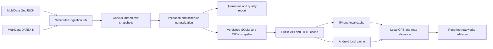

# Baden Württemberg roadworks live service specification

Status: implementation contract, originally assessed on 21 October 2026. Server
ingestion/cache/API and equivalent opt-in native clients are implemented locally;
see the [continuation record](V1_5_IMPLEMENTATION_CONTINUATION_2026-10-23.md).
The backend and native preference remain disabled by default. No deployment,
scheduler or public activation was performed. Historical source observations
and operational acceptance requirements below remain applicable.

## Feasibility and recommended scope

The BEMaS feed can support a useful service for **reported roadworks and closures near the driver**. It contains locations, direction, descriptions and validity periods. The public endpoints require no credentials, and the dataset licence permits reuse and redistribution with attribution. Its actual publication delay must remain visible to users: a frequently refreshed YouSpeed cache cannot make an older publisher snapshot current.

Cache the feeds once on `live-eu.woladen.de`, publish a small normalized BW snapshot, and select nearby events **on the phone using its existing GPS fixes**. The sampled statewide GeoJSON compressed to 209,025 bytes, so sending every GPS fix to a server adds little value at this scale. Provide a separate stateless nearby API for consumers that need it; both mobile apps should use the statewide snapshot by default.

Use GeoJSON for the publisher's selected event set and DATEX II for schedules, source status, version times and validated location enrichment. A GeoJSON-only implementation is sufficient for an exploratory map/list, but would misrepresent some work windows. Treat this as a separate advisory layer: it supplies no speed-limit offers, matcher restrictions, penalty changes, camera detections, sign-confirmation evidence or capture triggers. The protected speed-reference policy and offline map schema require no changes.

## Source and verified observations

Authoritative catalogue: [Baustelleninformationen Baden-Württemberg](https://mobidata-bw.de/dataset/baustelleninformationen-baden-wurttemberg). The publisher describes coverage of federal roads and classified state and district roads. The sample also contains municipal-road labels, but neither those labels nor the catalogue establish comprehensive municipal coverage. Autobahn works are published through separate MIA feeds listed on the [IPL API overview](https://api.mobidata-bw.de/); they are a later source integration with their own licence, deduplication and coverage assessment. Traffic incidents and diversion-management publications are also separate.

| Format | Published endpoint | Proposed use |
| --- | --- | --- |
| GeoJSON | [`roadworks_geojson.json`](https://api.mobidata-bw.de/datasets/traffic/roadworks/roadworks_geojson.json) | Selected events and line geometry |
| DATEX II v2 | [`roadworks_svzbw.datex2.xml`](https://api.mobidata-bw.de/datasets/traffic/roadworks/roadworks_svzbw.datex2.xml) | Work windows, status, versions, typed location enrichment |
| CIFS | [`roadworks_cifs.json`](https://api.mobidata-bw.de/datasets/traffic/roadworks/roadworks_cifs.json) | Diagnostic comparison, not an independent source |
| WFS/WMS/CSV | Links in the catalogue resource metadata | Inspection and GIS interoperability; unnecessary for native delivery |

The direct downloads completed at 18:10 UTC / 20:10 CEST on 21 October. The reproducible [evidence receipt](MOBIDATA_BW_ROADWORKS_2026-10-21.evidence.json) records the exact hashes, HTTP headers and profiling results. This is a single snapshot, not a measured update cadence or coverage benchmark.

| Observation | Verified result | Implementation consequence |
| --- | --- | --- |
| GeoJSON size and identity | 1,167,154 bytes; 1,043 unique event IDs | Full-state distribution is practical |
| Event types | 582 `CONSTRUCTION`, 461 `ROAD_CLOSED` | Separate work and closure labels |
| Geometry | 1,039 LineStrings and 4 Points; 31,284 vertices | Distance to the actual line, not its centre |
| Direction | 685 both directions, 358 one direction | Preserve point order and unknown applicability |
| Outer validity intervals at fetch time | 735 within the outer window, 278 future, 30 ended | Apply time filtering; 735 is not a count of confirmed active sites |
| Text quality | 342 descriptions are `Bauphase`; 350 road labels are `Gemeindestraße` | Use a localized fallback heading and retain source text in details |
| Duplicate content | 17 additional features identical after removing ID | Preserve identities; group only for presentation |
| DATEX II size and grain | 30,593,055 bytes; 627 situations, 3,510 records | Do not append every XML record as another app event |
| Candidate cross-format join | All 1,043 GeoJSON IDs matched a DATEX record after removing the final dot suffix | Version and test this adapter rule; it is not a documented permanent ID contract |
| Matched XML schedules | 164 records have valid periods, 12 have recurrence, 1 has exceptions | Compile schedules before calling an event temporally eligible |
| Matched operator status | 539 requested, 80 approved, 424 implemented | A time window alone does not prove work has started |
| XML speed-related fields | 250 `mainSpeedLimit` elements in the full XML | Preserve in research/raw evidence; exclude from the advisory rule path |

### Coordinate defect

All four GeoJSON Points are outside a broad BW sanity envelope because their coordinate pairs are reversed. For example, event `138434891-138481357-138481358-138492397-0-sperrung.001` has `[49.398903, 8.575976]`; the exact corresponding XML record names latitude `49.398903` and longitude `8.575976`. The CIFS conversion is also affected, so switching to CIFS does not fix this.

Quarantine these geometries by default. A versioned adapter may repair a Point only after an exact, unique XML record join verifies the named latitude and longitude, temporal compatibility and regional plausibility. Preserve the original pair, record `coordinate_order_repaired_from_datex`, and retain the XML hash and record ID. Never globally swap coordinates based solely on which order lands in BW. A repaired Point still cannot establish a directed road approach; show it only as nearby information.

### Freshness and direction limits

GeoJSON and CIFS HTTP `Last-Modified` were `2026-10-21T11:50:33Z`; XML publication time was `2026-10-21T13:07:09.686+02:00`, or 11:07 UTC. These were about 6 h 20 min and 7 h 3 min old respectively when downloaded. Successful HTTP responses do not establish current physical road conditions. The CIFS root timestamp has no time-zone offset and must remain an untrusted raw value until its convention is confirmed. CKAN metadata modification time is not feed freshness.

HTTP `ETag` and `Last-Modified` were present, and a subsequent conditional GeoJSON GET returned **304 Not Modified**. Poll with validators. A 304 updates the successful-check time, never the publisher-publication time.

The [CIFS specification](https://developers.google.com/waze/data-feed/cifs-specification) defines affected direction through polyline order. In this sample, converting CIFS `lat lon` pairs to GeoJSON `lon lat` agrees for normal lines. Validate the BW conversion against reviewed opposite-direction cases before using it for a claim such as “ahead on your road.” Point records and ambiguous road associations remain direction unknown.

## Server ingestion and storage

Backend implementation belongs in **`Woladen.de-analytics`**, following its `AGENTS.md`. Its existing YouSpeed service uses Python/FastAPI in the approved live-eu Docker Compose runtime. Keep public roadworks state in an isolated live-owned directory and SQLite/R-tree projection; management PostgreSQL on `volz-db` is not the app serving store. Reuse deployment, HTTPS, health and resource-limit conventions without coupling roadworks to sign-contribution identities or private media.



### Fetch and promotion

1. Run an externally scheduled Compose job every **5 minutes**, with a non-overlapping lease and small jitter. Identify the application with a descriptive User-Agent and operator contact; the IPL overview also requests reverse DNS. Use fixed HTTPS URLs, validators, 10 s connection / 60 s overall timeouts, bounded decompression, and exponential retry capped at 30 min. Honour `Retry-After`. These are proposed operating parameters, not publisher guarantees.
2. Save changed response bytes and headers to temporary files, calculate SHA-256, fsync and seal a raw manifest before parsing. Proposed decoded limits: 10 MiB GeoJSON and 64 MiB XML. Keep 30 days of changed raw objects with a storage quota; keep small provenance manifests longer. Do not archive repeated 304 bodies.
3. Parse GeoJSON as a complete collection and XML with external entities, DTDs and network schema resolution disabled. Validate collection shape, IDs, required types, finite coordinates, geometry sizes, regional bounds and offset-bearing timestamps. Empty `subtype` is valid. Unknown enums remain explicit unknowns and are excluded from stronger claims.
4. GeoJSON defines membership. Match its IDs to a unique XML record using the pinned adapter rule and compare source windows and versions. The observed suffix is a location/representation identity; do not remove it from the public event key. Avoid fuzzy joins by description or proximity. Fetches are not transactional: if timestamps differ by more than 15 min, required values conflict, or the XML record cannot be matched uniquely, retry the pair once and publish that event with schedule/direction unknown if still unresolved. An identical older XML record may be used only when its full relevant content and applicability are explicitly compatible; record both source revisions.
5. Normalize timestamps to UTC, preserve originals and the `Europe/Berlin` schedule interpretation. Expand supported XML valid periods, recurring weekdays and time-of-day windows, then subtract exceptions. Clip to the overall interval. Use half-open intervals `[start,end)`. Overnight windows and DST transitions need fixtures; ambiguous or unsupported recurrence yields `schedule_status=unknown`, never continuous activity.
6. Publish an evaluation window from **00:00 UTC today through 00:00 UTC eight days later**. Include events whose validity can overlap it; retain distant future events in server storage. Expand the window daily even if upstream bytes do not change. Sort/merge resolved intervals deterministically. A resolved event can have zero intervals when its work is outside this window. The apps only evaluate within this window.
7. Build SQLite tables and canonical UTF-8 GeoJSON in staging; validate cross-record counts and hashes, then switch one current-generation pointer atomically. Concurrent readers keep a consistent generation. Geometry repairs and row-level quarantines are reported. A truncated document, duplicate source ID, unexplained empty collection, over 25% membership collapse, or over 1% invalid required records blocks promotion pending investigation. These initial anomaly thresholds are configurable; a legitimate mass withdrawal needs a reviewed override.
8. Treat absence from a successfully promoted **complete** collection as source withdrawal, not proof the road reopened. Replacement snapshots remove the event immediately. A failed fetch, rejected candidate or incomplete parse never causes mass deletion. Preserve first/last seen, withdrawn time and revision lineage server-side. A later reappearance keeps the opaque publisher ID and a new content revision.

GeoJSON-only degraded publication may continue when XML fails, but schedule enrichment must become unknown when compatibility cannot be established. Never keep an old “active” interpretation by silently carrying forward incompatible enrichment. Quarantine metrics distinguish source defects from adapter failures.

### Data model

| Entity | Required content |
| --- | --- |
| `source_fetch` | URL, HTTP result, ETag, Last-Modified, fetched/check time, XML publication time, body hash, parser version |
| `generation` | Content hash, source hashes, generated time, evaluation window, accepted/quarantined counts, normalization version, previous generation |
| `roadwork` | Opaque namespaced source ID, event revision, type/subtype, German description, road label, original direction, normalized geometry, original properties |
| `validity` | Outer start/end, resolved UTC intervals, schedule status, original XML validity, operator status and source version time |
| `spatial_index` | Event bounds in R-tree; exact metric point-to-line/point calculation after candidate filtering |
| `quality_issue` | Event/source hash, failure code, repaired/quarantined disposition and evidence |

Use `mobidata-bw:bemas:<complete GeoJSON id>` as the public feature ID. IDs are opaque: no numeric conversion or UI parsing. A semantic revision hashes normalized event content; a snapshot ID hashes the exact uncompressed canonical snapshot bytes. Public snapshots omit raw XML, personal contacts and operational details. Preserve original public source evidence in the server archive.

Do not merge repeated phases, directional legs or closure/works records destructively. The app may group identical normalized geometry, intervals, type and text into one card while retaining every member ID. Similar text alone cannot establish the same worksite.

## Public API contract

Proposed base: `https://live-eu.woladen.de/youspeed/live/v1`. These routes are new. The accompanying [OpenAPI contract](MOBIDATA_BW_ROADWORKS_API.openapi.json) describes the JSON shapes. No account, contribution grant, installation UUID or API secret is required.

| Method and route | Behaviour |
| --- | --- |
| `GET /regions/DE-BW` | Current snapshot reference, coverage, freshness clocks, source status, attribution and feature availability |
| `GET /regions/DE-BW/snapshots/{snapshot_id}` | Immutable normalized GeoJSON containing the bounded evaluation window and all accepted events in it |
| `POST /regions/DE-BW/roadworks/nearby` | Optional stateless spatial query for other consumers; coordinates in JSON, not URL logs. Both apps use local filtering instead |

The region manifest has separate `source_publication_at`, `source_modified_at`, `last_checked_at`, `last_ingested_at` and `server_time` values. Missing publication time is null; it must not be replaced with fetch time. `source_modified_at` comes from the selected GeoJSON representation. For enriched generations, freshness uses the **older** trustworthy GeoJSON modification and XML publication time. A required missing/untrustworthy clock yields `unknown`. A check after rejected promotion cannot freshen the currently served generation.

Proposed status and display policy:

| Status | Condition | App behaviour |
| --- | --- | --- |
| `fresh` | Successful validation/check within 15 min and required source clocks no older than 30 min | Normal “reported roadworks” presentation |
| `delayed` | A usable generation remains, but check or source-age limit is exceeded; source age at most 24 h | Show source age and “updates delayed”; claims remain reported information |
| `unknown` | Required source age cannot be established | Parked list with freshness unknown; no driving card |
| `unavailable` | No accepted generation, source older than 24 h, or service disabled | No driving card; distinguish unavailable from zero events |

A snapshot remains available for inspection even when the manifest marks it unavailable. Also stop driving presentation when the app has been unable to validate the region manifest for 24 h, even if its old source timestamp appears fresh. Respect HTTP `Date`/`Age` when anchoring cached manifest time, then use elapsed monotonic time; clock rollback or inconsistent time requires a new manifest. The app derives age offline rather than freezing the last received status.

Manifest responses use `Cache-Control: public, max-age=60, must-revalidate`. Snapshot responses use `public, max-age=31536000, immutable`, gzip/Brotli and `Vary: Accept-Encoding`. Use a representation-correct ETag, with weak validators acceptable for equivalent compressed variants. Return 304 for matching validators. Dynamic manifest freshness clocks do not change immutable snapshot bytes. The client verifies the decompressed snapshot SHA-256 against its requested ID before replacing its cache. Retain referenced immutable generations for at least 30 days; an expired one returns 410 and requires a manifest refresh.

Clients ignore unknown additive fields. An unsupported `schema_version` preserves the previous cache and reports an update requirement; it must not partially install the new generation. New required meaning or incompatible units require a new major schema/API version. Unknown event meanings remain ineligible for driving presentation.

A snapshot is complete and unpaginated within its declared window. Initial limits are 10,000 features, 200,000 vertices and 8 MiB decoded / 2 MiB compressed. Exceeding a limit produces a visible service/schema issue; never silently truncate the statewide product. Bound event text, reject non-finite values and publish plain text only.

The optional nearby operation accepts latitude, longitude and radius 100–10,000 m, defaults to 5,000 m, and returns at most 200 features with exact distance to geometry and `truncated`. It returns all time candidates in the snapshot window, leaving schedule evaluation explicit. Sort by distance then ID; do not claim route relevance. Results carry snapshot ID and freshness and use `Cache-Control: no-store`. Disable request-body tracing and coordinate logs; accept no persistent identifiers, retain no query history and use bounded in-memory abuse protection. Ordinary infrastructure still processes IP addresses, so do not describe the service as unobservable or anonymous in an absolute sense.

Use structured errors: 404 unknown region/snapshot, 410 expired snapshot, 422 invalid location/radius, 429 rate limit with `Retry-After`, and 503 when no accepted generation can serve the request. A known region with unavailable current data returns a 200 manifest with null snapshot reference. A valid query with no matching records returns an empty array, not 404. Health/liveness remains distinct from provider freshness; report provider failure through manifest/metrics without repeatedly restarting a healthy API.

## Integration in both apps

### Shared behaviour and proposed defaults

Add **Settings → Live roadworks** with one switch, initially off, on both platforms. Enabling it explains that BW information is refreshed from YouSpeed over the internet, proximity is evaluated locally, source coverage is partial and the publisher may be delayed. Downloads use Wi-Fi and cellular while enabled; there is no Android-only policy. This proposal requires no location sharing, account, camera, sign-contribution consent or Panoramax access. Keep those independent product flows independent.

Refresh the manifest at drive start, foreground resume and every 5 min during an active foreground drive, with one in-flight request and jitter. Only fetch a changed snapshot ID. Suspend network refresh outside an active foreground session, except explicit parked refresh. Do not add background location permission or persistent background jobs. Reuse the existing GPS intake; start no additional GPS stream. Entering BW or a 10 km border prefetch margin is decided locally; neighbouring-country driving remains usable without the feature. If location is unavailable, a parked user can explicitly download BW data.

Maintain current and previous validated snapshots in a separate bounded local cache, plus ETag, region manifest and time anchors. Atomically install decoded data off the UI/camera/map-lookup queues. Cancellation, 304, timeout, oversized reply or malformed content retains the last valid cache and updates status. Feature off cancels requests and removes driving presentation immediately; cached public data can be cleared in settings. It has no effect on local recordings or offline maps.

Retry temporary failures after 30, 120 and 300 s with jitter, then at the normal refresh interval; respect a longer `Retry-After`. Do not retry permanent contract/HTTP failures in a tight loop. Re-entering the foreground can perform one new manifest attempt, with the same one-request limit. A missing or stale cache must never block starting a drive.

Do not reuse `SignCollectionHTTPClient` unchanged: its current transport disables compression, restricts paths and bounds replies at 512 KiB. Introduce a dedicated read transport with the public snapshot limits, cancellation and HTTPS origin/path validation. Sharing low-level utilities is reasonable; sharing contribution identity, consent or upload scheduling is not part of this service.

### GPS relevance and presentation

1. A usable driving fix is at most **3 s old**, has finite coordinates and horizontal accuracy at most **50 m**. These proposed gates match the existing application's conservative location handling. Hide the card when the fix expires; do not keep the last location indefinitely. Approximate/network-only location may populate the parked nearby list but cannot assert a directed approach.
2. Query local event bounds within **5 km**, then calculate minimum geodesic/locally projected metric distance to every candidate line segment or Point. A long worksite must be detected from its middle. Keep original geometry for evaluation; display simplification cannot determine distance or heading.
3. Check the evaluation-window coverage and resolved schedule at the current trusted time. Exclude expired/inactive intervals. Unknown schedules may appear in a parked list labelled “work period uncertain”; they cannot produce an active driving card. Operator `requested`/`approved` remains “planned/reported,” even within its time window. `implemented` remains a publisher report, not physical verification.
4. Show one passive **nearby** card within **500 m**, after two consecutive eligible fixes. Retain it until distance exceeds 750 m, eligibility ends, GPS becomes unusable or the source becomes unavailable. Use deterministic ordering: verified same-road relevance, then reported closure, then distance, then opaque ID. These are product proposals to validate with replay and real roads.
5. “Ahead on your road” requires a trusted directed road association, compatible local tangent, topology and forward along-road distance. A circle, heading alone, same road-name string or nearest OSM way is insufficient. In v1, use the neutral nearby wording whenever that evidence is missing. Do not require an offline bundle for ordinary nearby display. Do not introduce route calculation solely to obtain a stronger label.
6. Keep speed, warnings and current camera/bundle signs in their existing slots. Add the advisory below them, with road name, rounded distance, reported closure/works, source age and delayed/offline marker. Full text, dates, direction uncertainty, source status and grouped member IDs are available in the parked detail view. No new modal, sound or speech during driving is included in v1. Suppress interactive details through existing driving-control gates.

Use the existing shared `de-123` artwork if a roadworks pictogram is shown. An event is not evidence that the physical sign was seen. Closure text may use a neutral UI symbol; it must not manufacture a traffic-sign asset or imply camera confirmation. Localize UI labels in DE/EN/FR/NL; retain source German text with its language identified. Support VoiceOver/TalkBack and avoid colour-only freshness distinctions.

Empty state copy is “No reported roadworks nearby in the available data,” scoped to the configured 5 km list radius. Outside coverage, data unavailable, unknown freshness, no GPS, no local map, source delayed and valid empty results are separate states. Lack of a map affects only stronger road association, not cached spatial proximity.

### Native integration points

| Concern | iPhone reference | Android equivalent |
| --- | --- | --- |
| Location input | `DriveSessionViewModel.locationManager(_:didUpdateLocations:)` | `ConsumerSessionController.consumeLocation` after precise-location intake |
| Matched-road evidence | Accepted `updateSpeedLimit` result and current context generation | Accepted lookup result and current source/context generation |
| New independent runtime | Proposed `RoadworksService`, `RoadworksStore`, `RoadworksRelevance` | Equivalent Kotlin service/store/relevance components |
| Driving card | `MainView.swift`, below existing inventory/secondary presentation | `ConsumerAppUi.kt` with equivalent layout and `ConsumerUiState` |
| Settings and details | Existing settings/legal view structure | `ConsumerParityUi.kt` and existing settings/detail surfaces |
| Attribution | `shared/attributions/sources.json` and Sources and credits | Consume the same shared attribution bytes |
| HTTP reachability | Dedicated `URLSession` client; `NWPathMonitor` as a hint | IO worker/coroutine and validated `ConnectivityManager` network |

Consume location independently of successful speed-map lookup: the iPhone speed lookup currently returns early when no service is installed. A late HTTP response must only update the cache; relevance is recalculated against the **latest** fix and drive-generation token. Ending a drive, disabling the feature or changing source generation invalidates stale callbacks. Keep networking out of synchronous location, camera and speed-reference work.

Both apps receive the same schema and compiled UTC intervals. Add versioned shared JSON fixtures for normalization output, spatial cases, status transitions, tie-breaking and expected presentation. Swift and Kotlin interpreters must produce the same decisions from those fixtures. Inspect the final iPhone implementation first when implementing Android parity.

## Attribution and privacy

The catalogue declares [Datenlizenz Deutschland Namensnennung 2.0](https://www.govdata.de/dl-de/by-2-0). It permits commercial and non-commercial processing and redistribution with the provider name, licence link, dataset link and a notice of modifications. Proposed credit: “Verkehrsministerium Baden-Württemberg, BEMaS, via MobiData BW; dl-de/by-2-0. Data normalized, spatially filtered and, where documented, coordinates corrected by YouSpeed.” Confirm any provider-specified attribution wording before release.

Return attribution in the manifest and snapshot and keep it readable offline in both apps. Update privacy/help and store disclosure answers to reflect the new optional download service and its actual logging. Default app requests contain region and snapshot identifiers only; GPS, heading, road IDs, sign observations and installation UUID stay out of those requests. Do not join roadworks access logs with sign-contribution records. This specification authorizes no external messages or changes to store submissions.

## Operations and acceptance

Track per-source last attempt, successful check, body change, publication age, fetch bytes/duration, parse errors, join coverage, schedule unknowns, repaired/quarantined geometry, event counts, promotion failures, API latency, response bytes and cache-hit rate. Alarm on failed promotion, repeated fetch failure and source publication age beyond 30 min; avoid one alert per unchanged poll. A seven-day observation of update times and errors is a launch measurement, not an automation created by this specification.

Targets for the new implementation: changed publisher bytes become available within 10 min at p95; nearby API responds within 200 ms at p95 under a measured pilot load; app relevance consumes under 5 ms at p95 for the sampled dataset. These are acceptance targets requiring benchmarks, not measured results. Preserve at least one previous known-good generation, roll back the current pointer independently of app releases, and provide a region-disable flag in the manifest. A previously cached app may take up to the refresh interval to observe disablement.

The sampled source needs about 31 MiB per fully changed ingestion pair. At 5 min polling with no useful 304s, ingress could approach 9 GB/day; use conditional requests and measure actual changes before sizing storage. The raw GeoJSON sample is about 204 KiB gzip; a hypothetically changed payload every 5 min is about 2.4 MiB per driving hour, plus manifests. Enriched payload size and real change frequency remain to be measured. Statewide JSON behind HTTP caching and a SQLite/R-tree store is adequate to start; no new Redis, PostGIS serving cluster or message broker is justified by this sample.

| Work package | Deliverable and acceptance |
| --- | --- |
| Source observation | Measure publication cadence, status lag, availability and cross-format synchronization over seven days; verify attribution, point fixes, direction and schedule examples |
| Backend adapter | Raw provenance, exact joins, schedule expansion, quarantine, complete-snapshot withdrawal, atomic recovery and rollback; source failure never erases all events |
| Public service | Implement OpenAPI routes, immutable hashed snapshots, cache headers, structured failure states, operational metrics and coordinate-log exclusion |
| iPhone reference | Opt-in settings, dedicated transport/cache, local relevance, all unavailable/delayed/offline states and parked details |
| Android parity | Same settings, defaults, fixtures, limits, UI meaning and failure transitions after inspecting the iPhone implementation |
| Joint pilot | Recorded/replayed road cases and attached-device acceptance when deployment is explicitly requested; no speed-reference policy byte or semantic changes |

Required fixtures include the four swapped Points, a line queried near its middle, parallel roads, opposite carriageways, a Point with unknown bearing, no map installed, two identical records with different IDs, source removal/reappearance, future/ended works, working-day and overnight schedules, exception periods, the 25 October 2026 DST change, requested versus implemented status, unchanged 304s, conflicting XML/GeoJSON generations, malformed/truncated/empty source payloads, clock rollback, app restart offline, stale GPS, region exit, feature-off cancellation and a delayed reply after drive end.

Before public activation, settle the observed publisher delay, attribution wording and the proposed thresholds/defaults in this specification. A source that routinely publishes every several hours can still support useful **reported worksite information**, with honest age labels; it cannot support a promise of minute-current closures. Adding Autobahn/incident feeds, route avoidance, audio alerts or any effect on the active speed limit is separate product scope. Activation, deployment and publishing require explicit approval under the repository policy.

## Reproducing the source assessment

Use public HTTPS GETs to save the three endpoints and their response headers outside the repository as `roadworks.geojson`, `roadworks.cifs.json`, `roadworks.datex2.xml`, `geojson.headers`, `cifs.headers`, and `datex.headers`. Save the [CKAN package metadata](https://mobidata-bw.de/api/3/action/package_show?id=baustelleninformationen-baden-wurttemberg) as `catalogue.json`. Then run:

```sh
python3 scripts/research/profile_bw_roadworks.py /path/to/downloads
```

The checked evidence receipt contains the original assessment hashes. A fresh download will naturally produce different counts and hashes as the publisher changes data. The profiler validates the research observations; it does not implement production ingestion or schedule interpretation.

Specification validation: the OpenAPI file passes the [official OpenAPI 3.1 structural schema](https://spec.openapis.org/oas/3.1/schema/2022-10-07); its 14 component schemas pass JSON Schema 2020-12 checks, local references resolve, and representative valid/invalid request and geometry cases pass. Evidence totals, the four XML-confirmed reversed Points, all 1,039 normal line sequences and the conditional 304 were checked. These checks validate this design artifact, not a running backend or native implementation.
