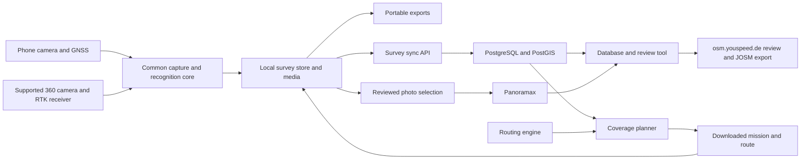

# OpenSignMap product concept and engineering assessment

Draft for product review · 4 November 2026 · Source baseline `ae1db1bb` on `codex/youspeed-v1.5-mobidata-bw`

**OpenSignMap should be a dedicated Android street-survey application, built from YouSpeed's capture and recognition capabilities and qualified on one reference phone.** Its central workflow is to plan an area, capture street imagery and observations, inspect the evidence, and export or send selected material for mapping. It retains traffic-sign recognition (TSR), optical character recognition (OCR), the full existing sign catalogue, and Panoramax uploads. It adds a map/camera/timeline workspace, a durable observation database, town-coverage missions, external Centipede RTK positioning, and supported 360° cameras. YouSpeed continues on iPhone and Android; OpenSignMap has no initial iPhone delivery requirement.

The project is feasible. YouSpeed already supplies the native mobile foundation: camera capture, on-device recognition and supplementary OCR, sign artwork, a structured local journal, exports, Panoramax authentication and upload recovery. OpenSignMap should retain that Android stack. A clean common-core boundary, mapping-specific journal semantics, reliable observation synchronization, area-coverage planning and external-device integration are significant new engineering work; replacing the application framework is not part of the plan.

**Recommendation:** use three repositories: `youspeed.de`, `opensignmap`, and a neutral `opensign-core`. Ship a useful Android mapping beta and qualify one reference phone, RTK receiver and 360° camera in parallel. Budget **6–10 AI-assisted person-weeks for the local phone MVP**, **16–28 for the phone-based town-mapping product**, and **27–48 for the complete scope including one qualified RTK/360° rig, live external preview and panoramic recognition**. These are planning estimates with explicit assumptions below.

## Product scope

OpenSignMap serves volunteer OpenStreetMap contributors, organized mapping groups and street-inventory projects. A person can use the reference phone alone; a more capable rig adds an external GNSS receiver, antenna and 360° camera. Other Android devices may work, but the first release's supported configuration is the explicitly qualified reference device and rig.

| Keep and adapt from YouSpeed | Remove from OpenSignMap | Add for mapping |
| --- | --- | --- |
| TSR, existing national models, shared official sign artwork, supplementary OCR | Active legal-speed resolver, speedometer-focused dashboard, speeding alerts, penalty calculations and fine tables | Live map with street name, camera preview and observation timeline |
| Geolocated street photos, optional local video, camera lifecycle and recovery | Upcoming-limit assistance, overspeed colours, enforcement-oriented relevance decisions | Projects, durable survey sessions, searchable observation history and review |
| Panoramax account connection, photo selection and post-session upload | Driving-rule and conditional-limit execution as user advice | Observation database, portable exports and processing jobs |
| Location quality, road candidates, model provenance and storage utilities | Tax/odometer-oriented trip journal workflow | Area coverage, route planning and following, external GNSS and 360° capture |

**Speed signs remain mapping data.** A saved observation can say “50 km/h sign seen here, with this image and supplementary text.” It does not assert that 50 km/h currently governs the vehicle. Zone entries/exits, restriction ends, town boundaries, temporary signs and conditional plates remain observable objects. Route planning and image cadence may still use movement speed internally.

“All signs” means retaining all supported recognized classes and uncertain/unknown sign evidence, including signs facing another road or direction. It does not promise that existing models recognize every sign worldwide. The live selectors currently include bundled DE, FR, NL, BE and CH packs; country qualification, calibrated accuracy and signed downloadable distribution are separate concerns. CH has an owner field-acceptance record. [Current iPhone catalogue](../iphone/SpeedConsumerApp/TrafficSignPresentation.swift), [Android catalogue](../android/app/src/main/java/de/youspeed/android/alpha/TrafficSignDisplay.kt), [CH acceptance](../shared/tsr/field-acceptance/CH-v9-2026-09-27.json).

Initial street-information capture includes street names from map context, manual notes/bookmarks, sign text, supplementary plates and image evidence. Recognition of house numbers, complex direction boards, road markings, surface condition or street furniture is a later evaluated extension. Existing supplementary OCR does not establish these capabilities.

## Comparison with existing Panoramax apps

**YouSpeed is the strongest starting point for this product among the implementations reviewed.** It already combines phone capture and Panoramax upload with live on-device TSR/OCR, structured GPS/sign/media evidence, portable exports and offline road context. The other mobile apps are useful workflow references; Prolix belongs to a separate server/workstation processing layer. OpenSignMap's work is to extract and adapt YouSpeed's existing capabilities, then add survey projects, review, coverage missions and the qualified rig.

| Already implemented in YouSpeed | OpenSignMap adaptation or extension |
| --- | --- |
| Kotlin/Jetpack Compose UI and CameraX capture, including preview, stills, optional video and recognition | Mapping workspace and separate survey-session controller |
| On-device LiteRT detector/classifier, national sign catalogues and bundled ML Kit supplementary OCR | Preserve all mapping evidence independently of speed applicability; evaluate panoramic views |
| Generic sign encounter tracking and OCR/evidence association | User-facing sign timeline, review revisions and persistent physical-sign hypotheses |
| SQLite journal with GPS, TSR, media and gap events; GPX/GeoJSON tracks and JSON/CSV sign discoveries | Extend the schema and projections for mapping; retain loops/stationary captures and preserve export compatibility |
| Retained journal-detail code with geographic replay, selectable timeline and linked video seeking | Adapt these components into the live survey workspace and dedicated review flow; they are not the current simplified history screen |
| Panoramax authentication, reviewed photo uploads, durable queue and recovery | Reuse the uploader and associate published originals with survey observations |
| Offline road matching and street names | Map pane, coverage overlay and route following |

Sources: [Android dependencies](../android/app/build.gradle.kts), [camera and recognition runtime](../android/app/src/main/java/de/youspeed/android/alpha/AndroidTrafficSignRuntime.kt), [on-device OCR](../android/app/src/main/java/de/youspeed/android/alpha/AndroidTrafficSignSupplementaryOCR.kt), [generic sign observer](../android/app/src/main/java/de/youspeed/android/alpha/SignCollectionObserver.kt), [existing exports](../android/app/src/main/java/de/youspeed/android/alpha/TripJournalFiles.kt), [retained review UI](../android/app/src/main/java/de/youspeed/android/alpha/TripJournalUi.kt), [journal contract](../shared/trip-journal/README.md), [Panoramax protocol](../shared/PanoramaxUploadProtocol.md). Reusing the journal does not remove the need for mapping-specific lifecycle and durable cloud-sync work.

The original **Panoramax/Panoramax photo** client has Android and iOS store listings. Its reviewed implementation uses Flutter/Dart and provides photo sequences, local sequence storage, GPS-quality information and photo-time location interpolation. Its latest listed GitLab release is v1.7.2 from 2 June 2025. [Official source](https://gitlab.com/panoramax/clients/mobile-app/-/raw/main/README.md), [capture implementation](https://gitlab.com/panoramax/clients/mobile-app/-/blob/main/lib/service/capture_service.dart), [release](https://gitlab.com/panoramax/clients/mobile-app/-/releases/v1.7.2), [iOS listing](https://apps.apple.com/fr/app/panoramax-photo/id6677045203).

In a 28 July 2026 team forum post, Christian Quest reported that the original mobile client was no longer maintained and pointed Android users toward Baba or OpenCamera. Treat this as a dated maintenance warning when choosing a dependency; an accessible store listing alone does not establish active maintenance. [Team forum post](https://forum.geocommuns.fr/t/panoramax-test-de-lapplication-nomade/3349).

**Baba** is the especially relevant Android comparison. Its documented workflow includes individual photos/sequences, deleting pictures before upload, changing photo locations, naming sequences, and sending selected or all unsent sequences. Its Kotlin Multiplatform project states an Android/iOS objective, while the reviewed download links establish Android distribution; an iOS release was not verified. Its Play listing reports an update on 29 July 2026. [Baba README](https://gitlab.com/ravenfeld/baba/-/raw/main/README.md), [Play listing](https://play.google.com/store/apps/details?id=com.ravenfeld.panoramax.baba).

| Capability | Original Panoramax mobile client | Baba | OpenSignMap target |
| --- | --- | --- | --- |
| Phone imagery and sequence upload | Documented core function | Documented core function | Reused foundation |
| Pre-upload organization | Sequence/gallery workflow | Photo deletion, sequence naming, position correction | Adds sign-level review and evidence revisions |
| Mapping display | Proposed three-pane workflow not established | MapLibre integration documented | Persistent map, camera and sign timeline |
| Live on-device TSR and supplementary OCR | Not established in reviewed implementation | Not established in reviewed documentation | Existing YouSpeed capability adapted to mapping |
| Durable structured sign journal and portable exports | Photo-sequence storage; proposed journal not established | Proposed journal not established | Adapt YouSpeed's existing evidence journal and exports |
| Town coverage missions and route following | Not established | Not established | New planning and following service |
| Integrated RTK quality and external 360° control | Not established | Not established | One explicitly qualified rig |
| Application foundation | Flutter/Dart capture client | Kotlin Multiplatform capture client | Retain YouSpeed's Kotlin/Compose/CameraX foundation |

“Not established” means the inspected source/docs do not demonstrate the capability, not that every release or extension has been exhaustively excluded. This is a source-backed comparison, not a hands-on quality or battery benchmark of the competing apps.

**Prolix is a server/workstation batch-processing tool, not an on-device mobile recognition implementation or an app framework.** Its installation uses Python and PyTorch with a GPU; its documented workflow downloads stored Panoramax pictures, runs detection/classification and analysis, writes GeoJSON and optionally uploads annotations. It can support later processing or independent comparison of submitted evidence. It does not replace YouSpeed's live CameraX/LiteRT/OCR pipeline, and sharing a model lineage does not make the execution architectures equivalent. [Prolix installation](https://gitlab.com/panoramax/clients/prolix/-/raw/main/docs/Install.md), [batch workflow](https://gitlab.com/panoramax/clients/prolix/-/raw/main/docs/Usage.md).

Panoramax's semantics API stores image-bound annotations and model/confidence metadata; that storage/API capability likewise does not establish live mobile inference. Retain Panoramax as the imagery and annotation destination, with Prolix an optional downstream worker. [Semantics API](https://docs.panoramax.fr/backend/install/deep_dive/semantics/).

### Framework decision

**Keep YouSpeed's native Android framework and extract its reusable modules into `opensign-core`. No reviewed capability justifies rebasing onto another app framework.** Its current Kotlin/Compose/CameraX, LiteRT and bundled ML Kit stack already addresses the difficult mobile integration work. Camera timing, backpressure, recording coexistence, model preprocessing, evidence association and recovery would all need revalidation after a rebase.

| Alternative | Potential benefit | Decision for OpenSignMap |
| --- | --- | --- |
| Original Panoramax Flutter app | Existing capture/upload screens | No demonstrated functional gain over the existing YouSpeed foundation; adds native bridging and lifecycle reintegration |
| Baba application base | Capture UX and Kotlin/MapLibre examples | No demonstrated replacement for YouSpeed's recognition/evidence pipeline; useful reference without adopting its whole application architecture |
| Individual mapping or camera library | A renderer, routing adapter or supported hardware protocol | Integrate behind an interface in the current stack when a concrete gap warrants it |
| Prolix | Batch sign processing on a server/workstation | Optional backend integration; unrelated to the Android framework choice |

Baba's documented use of MapLibre does not require adopting Baba or Kotlin Multiplatform to add a map to YouSpeed's Android foundation. Likewise, RTK and 360° support call for device adapters and qualification, not a new UI framework. The large current controllers justify incremental module extraction; they do not by themselves justify discarding the integrated runtime.

Reconsider a framework change only if a measured blocker in the current stack cannot reasonably be addressed with a module or native adapter, and a working alternative demonstrates lower total integration and maintenance cost. No such blocker or demonstrated advantage has been established. External component reuse remains selective and evidence-driven. The app repositories declare AGPL; Prolix declares MIT. Preserve exact selected code/model licences and notices. [Baba architecture and libraries](https://gitlab.com/ravenfeld/baba/-/raw/main/README.md), [Prolix licence declaration](https://gitlab.com/panoramax/clients/prolix/-/raw/main/README.md).

## User experience

The main workflow is **Project → Prepare → Capture → Review → Export or send → Resume remaining coverage**. An account is unnecessary for local capture and export. Connecting to a database or Panoramax is a separate action.

### Capture workspace

In landscape, the map and camera share the upper workspace, with a chronological sign strip beneath them. Portrait stacks the map and camera above a compact timeline. Users can resize or temporarily maximize either pane. Street name and the next route instruction remain legible without obscuring the camera.

| Workspace region | Contents and behaviour |
| --- | --- |
| Header | Project, street name, recording state, current camera, phone GNSS/RTK quality and storage remaining |
| Map | Position with uncertainty, camera direction where known, planned route, captured track, observation markers and missing coverage |
| Camera | Clearly labelled phone or external-camera source, live preview, detection boxes, capture health; a fixed forward viewport while driving |
| Timeline | All sign sightings, with a prominent **Speed signs** filter; pictogram, time, interpreted value/text and review status |
| Controls | Start/pause/stop capture, bookmark, optional video, capture-health details; detailed inspection and correction when stopped |

Selecting an observation after capture synchronizes the map, photograph/video moment and timeline. A detail view shows the original crop and full scene, predicted class, OCR, location quality, direction, road candidates and later corrections. Users can confirm, correct, mark uncertain, group duplicates, add a note, export a selection or send it to a chosen processor. “Saved locally,” “synchronized,” “Panoramax processing” and “published” are distinct states.

Every qualified sighting is saved locally; inspecting or starring an item must not be necessary to retain it. Repeated frame detections become one encounter with supporting frames. A later encounter with the same physical sign is retained as separate evidence and may be linked during review.

### Session behaviour

Starting a survey explicitly opens a persistent mapping session. It survives pause/resume and interrupted-process recovery, and retains short journeys, stationary notes and loops returning to their starting point. Missing maps, an unknown street, no road match or temporarily unavailable TSR must not prevent imagery and position capture.

The app records gaps for unavailable location, camera disconnection, thermal pauses, storage exhaustion and permission loss. It preserves already committed observations when storage is low, explains which capture stream stopped, and never silently deletes a saved survey to satisfy a cache limit.

The preview does not require retaining a movie. Optional video is a separate evidence source; Panoramax receives selected stills. In a hybrid rig, the phone may provide live TSR while the external camera records panoramic originals. The UI must identify these as different sources. Hybrid mode is a useful interim capability, not completion of true live external-camera recognition.

## Evidence and the speed-sign database

Define a general mapping-observation schema on the existing journal/storage foundation rather than extending the speed-correction table indefinitely. Reuse the event recorder, persistence, export and media-association machinery where its contracts fit. The database separates what was measured, what a model suggested, what a reviewer decided, and what might later become a map edit.

| Entity | Essential information |
| --- | --- |
| Project and mission | Area, capture mode, target road segments/directions, map revision, quality policy and progress |
| Survey session | UUID, start/end, device/app/core versions, recording choices, lifecycle and interruption history |
| Position sample | Measurement time, original coordinates/reference frame, source, uncertainty, heading and quality; RTK metadata when available |
| Media item | Original identity/hash, camera/profile, capture time, clock quality, projection, calibration, location association and local/remote availability |
| Sign observation | Stable UUID, session/time, source frame(s), bounding geometry, class candidates, numeric value/unit, OCR/plate association, model versions and scores |
| Review revision | Confirmed/corrected/uncertain status, changed fields, reviewer, expected prior revision and supporting evidence |
| Physical sign hypothesis | Optional grouping of observations, estimated sign position with uncertainty, facing direction and identity confidence |
| Road assertion | Separately reviewed road/segment, direction, proposed tags, validity/conditions and provenance |
| Delivery or processing job | Destination, selected evidence, idempotency key, progress, acknowledgement, results and retry/error state |

The **speed-sign database** is a filterable view of observations and reviewed assertions: location, observed numeric value/unit, sign/zone/end type, supplementary text, direction, date, image, review state and possible OSM road association. Start with SQLite on the device and a geospatial server database for optional synchronization.

Preserve three different locations:

1. **Receiver/camera position at exposure:** the measured or interpolated position of the capture rig.
2. **Estimated sign position:** nullable; initially a reviewer placement or a position hypothesis from multiple views.
3. **Applicable road segment:** nullable; a reviewed mapping interpretation that may differ from the closest road.

A speed sign observed 30 m ahead is not located at the camera's GPS coordinate. Without a sign-position estimate, the map/export explicitly labels the point as an approximate observation location. Unknown precision stays unknown. Raw scores are not displayed as calibrated probabilities, and OCR ambiguity is retained.

A surveyed speed sign does not automatically establish a complete speed-limit segment: direction, sign sequence, scope, conditional plates and current road topology need review. OpenSignMap can send those questions to `osm.youspeed.de`; it does not need YouSpeed's live speed-reference state machine to record them.

### Exports

The default portable ZIP contains versioned `observations.json`, `observations.geojson`, `observations.csv`, `track.gpx`, a media index and a checksum manifest. JSON is authoritative; CSV/GeoJSON are derived views that retain observation IDs and explicitly identify geometry meaning. GeoJSON uses longitude/latitude ordering and WGS84 output while preserving source-coordinate provenance in metadata. A GeoPackage is a useful subsequent GIS export.

Image/video bytes are included only when selected and available. Missing originals are reported rather than replaced by broken local paths. Support project/session/date/class/review-state filters, a speed-sign-only export, endpoint masking, and re-import without duplicated observations. Keep human corrections as revisions rather than overwriting model output.

A compatibility export should feed the existing `osm.youspeed.de` trip importer for supported speed evidence. A generic all-sign processing envelope is additive; existing speed-specific contracts remain valid for YouSpeed.

## Common core and repository structure

**Use two product repositories and a third repository for the common core.** Neutral ownership and independent package releases are worth the modest extra release-management work. Both products consume pinned core versions; neither product repository becomes the permanent upstream for the other.

| Location | Responsibility |
| --- | --- |
| `youspeed.de` | YouSpeed iPhone/Android shells, speed assistance and governed policy |
| Proposed `opensignmap` | Android app, survey workflow, projects, coverage, reference-device setup and mapping-specific integrations |
| Proposed `opensign-core` | Common Kotlin modules, retained Swift modules where useful to YouSpeed, shared contracts/assets/C++ utilities, fixtures and versioned package releases |
| Existing service repository | Existing Panoramax/crop/OSM service ownership remains in place; new survey APIs and workers get an explicit owner rather than an accidental duplicate backend |

The current OSM backend is documented in the sibling `Woladen.de-analytics` repository. The three-repository product/core structure does not require relocating existing services. Assign each new survey API/worker an explicit service owner and stable contract. [Existing service boundary](../inspector/README.md).

The core is **not currently a ready-made library**: the iPhone app compiles the app's Swift files together, and Android has a single app module importing the shared resource tree. Extract Kotlin modules shared directly by both Android products, retain Swift adapters used by YouSpeed, and keep shared contracts, assets and C/C++ utilities aligned. A common repository does not require one implementation language. Avoid combining extraction with a Kotlin Multiplatform or UI-framework rewrite. [iPhone build](../iphone/project.yml), [Android build](../android/app/build.gradle.kts).

| Common module | Boundary |
| --- | --- |
| Capture | Camera ownership, frame timing, independent preview/TSR/still/video consumers, interruption and resource handling |
| Recognition | Model validation/runtime adapters, detections, temporal tracking, OCR evidence, national taxonomy and shared official artwork |
| Location and road context | Position samples, uncertainty, street names, road candidates and portable provider interfaces |
| Evidence utilities | Serialization, storage primitives, media association, export and provenance |
| Panoramax | Instance authentication, queue, explicit upload/recovery and remote media references |
| Contracts and tests | Versioned schemas, golden fixtures, compatibility manifests and cross-platform conformance tests |

Expose neutral evidence **before YouSpeed's speed-applicability filtering**. YouSpeed consumes it through its unchanged speed-specific resolver; OpenSignMap consumes it through its mapping journal. Opposite-side, side-road, unmatched and uncertain signs remain useful mapping evidence.

Publish Swift Package Manager targets and Kotlin library artifacts from `opensign-core`, pinned to a compatibility manifest covering schemas, assets, models and services. Use explicit resource allowlists so OpenSignMap does not inherit penalty tables or speed-policy assets. Keep common fixes in the core repository, test affected YouSpeed iPhone/Android behaviour and OpenSignMap Android against candidate releases, and upgrade consumers explicitly. Avoid repeated fork merges or copied fixes.

OpenSignMap-only features need no Swift port. Its route UI, project workflow and first hardware adapters can live in `opensignmap`, depending on neutral core interfaces. Changes to behaviour that YouSpeed already shares across iPhone and Android still need parity checks. This concentrates new product work on Android without silently changing YouSpeed's existing commitments.

Extract in small steps: pin the existing baseline and fixtures, create narrowly scoped core packages, migrate YouSpeed consumers without behaviour changes, and then create the OpenSignMap shell against the same core release. Give each product separate app identity, settings, storage and release cadence. Maintain a compatibility check that builds the three app targets; run physical regression checks where a core change affects their capture or recognition behaviour.

Shared sign pictograms retain their existing official SVG/PNG bytes and provenance. Numeric speed signs retain a schematic rendering without penalty colours. New contracts are additive; extracting a library must not change YouSpeed's protected speed-reference policy, existing upload rules or marketing version 1.5.

## Services and processing

**Panoramax** remains the street-imagery publication destination. Reuse instance selection, per-user authentication and explicit post-session image review. Persist picture/sequence IDs after processing and link observations to the correct originals. Authentication, synchronization and public imagery publication are independent user choices. The existing contract already separates capture, upload acceptance and completed processing. [Client protocol](../shared/PanoramaxUploadProtocol.md).

**The survey service** is new durable infrastructure. Prefer PostgreSQL/PostGIS for projects, observations, revisions and coverage, with object storage for explicitly synchronized private media. Use stable IDs, an on-device transactional outbox, idempotent writes, per-item durable acknowledgements, retry/backoff, incremental downloads, revision conflicts and deletion records. A request timeout must not create a duplicate; an unacknowledged item remains recoverable. Backup/restore and access isolation are part of completion.

Suggested API capabilities, to be specified rather than assumed deployed: create/update projects and missions; upsert observation batches; upload selected media; retrieve changes by cursor; submit reviews with an expected revision; create and inspect processing jobs; export/delete user data. Keep source image/model evidence immutable and apply review changes separately.

**The database tool** should extend the existing Inspector's map, crop gallery and revisioned classification review where practical. Add project/session filters, speed-sign and all-sign views, an uncertainty layer, linked Panoramax images, review queues and export. Existing sign-position research can inform later work but is explicitly a conditional hypothesis, not established physical-sign truth. [Inspector](../inspector/README.md), [position estimator](../scripts/tsr/collection/triangulate_sign_position.py).

**`osm.youspeed.de`** is the downstream speed-proposal and JOSM-review tool. Its current sessions are temporary, expire within 30 minutes, and provide no persistent user/trip database. Keep that privacy contract unless separately redesigned. Initially send a selected export; later add an explicit, short-lived authorized handoff. General traffic-sign or street-information proposals need new processing support. OSM publication remains a user-reviewed editor step. [Current service behaviour](../inspector/OSM_REVIEW_README.md).

The current sign-contribution channel is explicitly best effort: it allows duplicates and loss, drops items after three failed attempts, and selectively creates crops. It can continue as an optional model-improvement channel, but cannot acknowledge a user's saved survey. OpenSignMap's saved evidence and media-retention choices must not depend on training-crop interest. [Contribution contract](../shared/tsr/collection-upload-v2.md).

Map tiles, routing and reverse-geocoding are separate services. MapLibre Native is a candidate Android renderer with regional offline packages; the existing map lookup bundles are not automatically a complete tile source or navigation graph. Standard OSM tiles must not be used for bulk offline downloads. Use an appropriate provider or hosted tile pipeline. [MapLibre Android](https://maplibre.org/maplibre-native/android/api/), [OSM tile policy](https://operations.osmfoundation.org/policies/tiles/).

## Town capture planning and route following

An area mission begins with a town boundary or drawn polygon, travel mode, start/end point, time budget, imagery freshness target and capture profile. The user can include/exclude road classes and inspect streets that cannot be reached with that mode.

Build a graph of eligible directed street segments, accounting for one-way roads, access and turn restrictions, separate carriageways, cul-de-sacs and disconnected areas. Assign capture requirements by segment and direction/view coverage. Generate manageable loops, allowing transit over already covered roads where necessary. A 360° camera can reduce repeat passes, but occlusion, divided roads and unreadable sign faces can still require another direction or visit.

Use an existing routing engine such as Valhalla for paths respecting mapped access and turn restrictions, maneuvers and matching. Add a dedicated coverage planner to prioritize required street segments and minimize unnecessary travel. Ordinary waypoint optimization does not solve “capture every eligible street in this area.” A practical first implementation can use greedy selection and local improvement rather than promise a globally optimal route. [Valhalla routing](https://valhalla.github.io/valhalla/api/route/api-reference/), [map matching](https://valhalla.github.io/valhalla/api/map-matching/api-reference/).

Route following displays the next maneuver, remaining mission, capture state and off-route recovery. Download the mission, route geometry and required maps before capture. The first version follows a downloaded route offline; fresh rerouting requires connectivity unless a separately scoped on-device routing engine is supplied. Capture continues during a routing-service outage.

Coverage states distinguish **planned**, **traversed**, **usable imagery captured**, **synchronized**, **published** and **reviewed**. Passing a road with a disconnected camera does not complete it. Compute coverage against the mission's versioned eligible segment/direction set and image-quality requirements, not an unknown count of all traffic signs. Mark inaccessible targets separately and preserve remaining work between sessions. Existing Panoramax coverage is a useful baseline only when date, direction, density and image quality satisfy the project.

## Centipede RTK integration

Centipede supplies positioning corrections; the rig still requires an external RTK-capable GNSS receiver and antenna. The phone forwards corrections where necessary and receives the corrected position plus quality telemetry. An ordinary phone GNSS fix does not become RTK merely by connecting to the service. [Centipede smartphone guidance](https://docs.centipede-rtk.org/fr/rover/smartphone-rover-apps).

The documented service currently uses RTCM3 corrections over NTRIP, with `crtk.net`, TLS port 443 for NTRIP 2.0, and `NEAR`/`NEAR4` nearest-base mountpoints requiring NMEA GGA. Use configurable profiles and prefer TLS. The app must disclose that automatic nearest-base selection sends receiver position to the correction service. [Centipede connection documentation](https://docs.centipede-rtk.org/access.html).

Introduce a `PositionProvider` interface for phone GNSS, a qualified external receiver and imported position tracks. Initially certify one receiver/transport on the reference Android phone. Evaluate documented Bluetooth, BLE, USB or Wi-Fi/TCP support against the actual receiver; use direct telemetry rather than relying only on Android mock location, which may omit RTK status and correction provenance. There is no initial iPhone accessory-integration requirement.

Store measurement time, receiver identity, solution type, reported horizontal/vertical uncertainty, correction age, base/mountpoint, source reference frame/epoch, and antenna-to-camera offset. HDOP alone must not be labelled as metre accuracy. Retain original measurements and record any coordinate transformation used for Panoramax/GIS export.

The UI distinguishes **RTK fixed**, **RTK float**, **standalone external GNSS**, **stale/no fix** and **phone fallback**. A source change is logged. The user chooses whether degraded accuracy continues capture with a flag or pauses the precision mission. Loss of internet may degrade RTK; it does not erase recorded evidence. A phone hotspot/cellular path must coexist with camera Wi-Fi and the receiver connection in the qualified rig.

RTK improves the antenna position, not automatically the camera or sign position. Calibrate the antenna offset, mounting orientation and exposure-to-GNSS clock relationship. At 50 km/h, a 100 ms timestamp error produces approximately **1.39 m** of along-road error (`50 / 3.6 × 0.1`). The existing journal's estimated media anchors can be up to two seconds and are unsuitable as precise capture timing. [Current timing contract](../shared/trip-journal/README.md).

Report measured image-location uncertainty, including timing and rig offsets. Do not advertise centimetre sign locations from an RTK-fix indicator. Physical sign geolocation requires additional geometry, repeated observations or a surveyed/manual placement.

## 360 degree camera support

Panoramax accepts ordinary and 360° street imagery and documents panoramic-camera capture, including external GPS/RTK use. The requirement here is **360° cameras**, following the clarified product request. [Panoramax camera guidance](https://docs.panoramax.fr/how-to-contribute/share-pictures/).

Deliver three explicit capabilities:

| Capability | Product behaviour | Qualification |
| --- | --- | --- |
| Import recorded panoramas | Import stitched geotagged 360° JPEGs or supported video-derived stills, align a GNSS track, review and upload | Projection/metadata, timing, source identity and Panoramax round trip |
| Control a supported camera | Connect, show status/preview, start/stop supported capture, associate original files and recover disconnections | Exact model/firmware and simultaneous capture/preview behaviour on the reference Android phone |
| Recognize panoramic imagery | Run TSR/OCR on corrected views and link results to original spherical coordinates | Tiling, seam deduplication, text resolution, sustained performance and field accuracy |

GoPro Max and QooCam 3 Ultra are reasonable **capture-profile candidates** from Panoramax guidance. They are not yet selected integration hardware. Confirm a documented SDK/control protocol and acceptable preview before committing to a model; GoPro Max and MAX2 must not be treated as interchangeable. [Panoramax practical guide](https://panoramax.fr/comment-participer-a-panoramax/guide-collecte-pieton-debutant).

Keep the high-resolution original on camera storage where appropriate and use a lower-resolution stream for the phone preview. Transfer originals after the session. Distinguish the image's exposure time from Wi-Fi receipt time. Open GoPro's general documentation describes reduced-resolution preview and minimum latency around 210 ms; this is a warning against treating a stream arrival as a shutter timestamp, not proof that a selected 360° model supports that stream. [Open GoPro FAQ](https://gopro.github.io/OpenGoPro/docs/faq/).

For recognition, transform a stitched equirectangular panorama into overlapping perspective views, run TSR/OCR, map detections back to the panorama and merge seam duplicates. Keep raw lens images, stitched originals and derived views distinguishable. Spherical geometry, stitching seams, stabilization, motion blur and reduced pixels per sign all affect quality. Evaluate existing country models on these views; substantial retraining is outside the first estimate.

A usable external preview may still be too low resolution for reliable OCR. In that case, keep live provisional detections and run the high-resolution recognition pass after import, with its later results visibly distinguished. A full live-preview milestone requires an actual supported external feed; a phone-camera substitute cannot satisfy that acceptance test.

Record projection, full/cropped panorama geometry, orientation, calibration identity, timestamp uncertainty and camera-location uncertainty. Preserve supported Panoramax metadata, including positioning error when justified; validate against the chosen instance. [Picture metadata](https://docs.panoramax.fr/pictures-metadata/), [position accuracy metadata](https://docs.panoramax.fr/pictures-metadata/quality_score/).

Capture efficiency must include storage and transfer costs. For illustration, 30 km/h at 10 m image spacing generates 3,000 panoramas/hour; at an assumed 10 MB each, that is **30 GB/hour before derivatives**. Measure actual files and readability before setting defaults. Show remaining capacity, use distance/quality-aware cadence, and support card import and interrupted transfers. Continuous 360° video is optional and requires a separate capacity/processing budget.

## Reference Android device

Optimize the first release for one documented phone model, OS build range and mounting/power arrangement. The qualification matrix should also pin receiver firmware, camera firmware and connection profile. This sharply reduces camera-driver variation and the number of hardware combinations that need field testing. Other phones remain outside the initial support guarantee; add devices only after running the same acceptance suite.

Use the existing **Moto g86 5G as the initial development baseline**, because the repository already contains device-install and camera-processing evidence for it. Those records do not establish that it is the best survey phone or that its complete RTK/360° rig is qualified. Select the supported reference model after an instrumented comparison, rather than from megapixel count or Bluetooth version alone. [Existing Moto benchmark](ROAD_PATH_ANDROID_BENCHMARK.md), [recent device record](DEVICE_DEPLOYMENT_2026-11-04.validation.json).

| Qualification dimension | Decision criterion |
| --- | --- |
| Phone camera | Readable signs and supplementary text in motion, useful exposure/focus control, reliable exposure timestamps, stable preview/still/inference combinations |
| Bluetooth and receiver | Required protocol exposed, stable delivery and reconnection, receiver quality telemetry preserved |
| Concurrent networks | External-camera Wi-Fi plus Bluetooth receiver plus cellular NTRIP; explicit network selection if the camera network has no internet |
| Sustained operation | 60–90 minute capture under representative mounting, sunlight and charging conditions, with measured heat, frame loss and memory/storage pressure |
| Power and storage | Practical external power, robust cable/mount, sufficient sustained write performance and an economical path for panoramic originals |
| OS maintenance | Foreground capture, permissions and recovery tested on the supported build range; updates requalified before expanding that range |

In a 360° rig, the external camera determines panoramic image quality. The phone's camera still matters for phone-only capture and a hybrid live-TSR configuration, while connectivity, sustained compute and thermal behaviour become equally important. Android-only scope removes the initial iPhone accessory and UI work; it does not remove synchronization or image-quality validation.

## Reuse limits that shape implementation

| Current capability or constraint | Required action |
| --- | --- |
| Neutral camera fan-out and native TSR/OCR already exist | Extract native modules and decouple preview from movie retention; preserve camera backpressure and independent consumers |
| General `SignCollectionObserver` explicitly separates sightings from speed applicability | Use it as evidence input, while removing road-match requirements from mapping eligibility |
| Current local correction model and Panoramax sign annotation assume speed values/operations | Introduce general observations and additive all-sign annotations; retain compatibility adapters |
| Current trip journal discards loops whose endpoints are less than 100 m apart | Reuse storage/export utilities with a separate survey lifecycle that always retains explicit captures |
| Current sign uploads permit loss and selective crops | Add a durable survey-sync path and independent evidence retention |
| Map replay and street names exist, but full live mapping/navigation do not | Build the split map workspace, map-source integration and route-following experience |
| Existing private crop review and sign-position hypotheses exist | Reuse review patterns; add project access, durable inventory and clearly qualified geolocation |
| Built-in camera/location providers are the current native sources | Add and physically qualify external receiver/camera adapters |

Key implementation sources: [camera recorder](../iphone/SpeedConsumerApp/PanoramaxRecorder.swift), [generic sign observer](../iphone/SpeedConsumerApp/SignCollectionObserver.swift), [speed-specific model](../iphone/SpeedConsumerApp/ConsumerModels.swift), [Panoramax annotations](../iphone/SpeedConsumerApp/PanoramaxCapture.swift), [journal lifecycle](../shared/trip-journal/README.md), [Android camera graph](../android/app/src/main/java/de/youspeed/android/alpha/DriveCameraGraphPlan.kt).

## Engineering effort and use of AI

One person-week is five working days of an experienced engineer, including code review and relevant tests. Estimates assume one Android OpenSignMap app on a qualified reference device, reuse of current models, an existing service-operating environment, one initial pilot region, and one selected RTK/camera rig. Core extraction includes necessary YouSpeed iPhone/Android regression work. They do not assume broad Android hardware support, an OpenSignMap iPhone app, proprietary camera stitching implemented from scratch, new model training, worldwide country qualification, offline rerouting, CarPlay/Android Auto or automatic OSM editing.

| Incremental phone-product phase | AI-assisted person-weeks | Comparable planning range without AI |
| --- | ---: | ---: |
| A Neutral core repository, package extraction, app identity and YouSpeed regression checks | 3–5 | 5–8 |
| B Android capture workspace, durable survey journal, review/exports and Panoramax reuse | 3–5 | 5–8 |
| C Durable sync API, database tool and selected-evidence OSM handoff | 4–7 | 6–10 |
| D Town coverage planning, downloaded routes, route following and progress recovery | 4–7 | 6–10 |
| E Reference-phone field trials, recovery/performance hardening and release preparation | 2–4 | 3–6 |
| **Phone-based town-mapping product** | **16–28** | **25–42** |

Cumulative milestones are **A+B = 6–10** person-weeks for an internal local phone MVP and **A+B+C = 10–17** for a connected beta. These milestones are not the full release qualification represented by E. Android-only scope reduces UI and accessory work substantially; core extraction, backend persistence and coverage planning still need their own engineering effort.

| Additional hardware work for one qualified rig | AI-assisted person-weeks |
| --- | ---: |
| H1 External RTK receiver, NTRIP, quality states and Android connection handling | 2–4 |
| H2 360° media import, original/track association, metadata and clock alignment | 2–4 |
| H3 Supported live external-camera control and preview adapter | 3–5 |
| H4 Panoramic TSR/OCR views, duplicate handling and quality evaluation | 2–4 |
| H5 Combined rig calibration, disconnect/network tests and additional field qualification | 2–3 |
| **Complete RTK and live 360° addition** | **11–20** |

**Complete requested Android scope: 27–48 AI-assisted person-weeks.** The earlier import-based rig milestone uses H1+H2+H5, adding 6–11 person-weeks, and can precede true live panoramic recognition. Hardware ranges depend on a suitable documented camera API; an unavailable API requires a different camera or a re-estimate, not an invisible scope reduction. H4 assumes existing models, provisional live recognition and a later high-resolution pass; full-resolution real-time 360° OCR is not guaranteed by this budget.

With two experienced engineers covering Android/core and backend/geospatial work, plus targeted iPhone regression review, product review and field-test participation, plan approximately **4–7 calendar months** for the complete scope. A phone MVP could be available in roughly **5–8 calendar weeks**. These calendar envelopes allow for dependency order, hardware availability and field trials; person-weeks are not divided mechanically by team size. Ongoing maintenance, storage/egress, routing infrastructure and additional hardware profiles need separate operating budgets.

AI should accelerate module extraction, Kotlin implementation, retained Swift adapters, serializers, API clients, database migrations, review UI, fixture creation and regression investigation. The phone comparison assumes roughly one-third less engineering effort; this is an estimating assumption, not a measured productivity claim for this project. Existing test fixtures and recognizable native patterns make that assumption more credible than for an entirely new codebase.

Human work remains decisive for product boundaries, device debugging, field capture, timing/calibration, recognition evaluation, routing quality and release decisions. Product AI should provide suggested classifications, OCR, duplicate groups and review priorities while preserving source evidence. Optional server vision-language processing must be an explicit destination for selected material, with its own cost and data-handling choice.

## Validation and delivery decisions

Begin with a **1–2 person-week feasibility slice within phase A**: prove the neutral evidence boundary and package approach in the existing YouSpeed Android stack, and shortlist receiver/camera interfaces for the reference phone. Framework replacement is not a workstream. Then select a pilot or loan rig and qualify its actual transport, preview and timing within H1/H3/H5. A complete vertical slice covering OpenSignMap Android, persistent loop capture, export/import, Panoramax and the physical rig should have **3–5 person-weeks allocated across the existing phase budgets**, not be promised inside the initial spike. Revise the hardware estimate before committing to full live-camera support.

| Acceptance area | Required evidence |
| --- | --- |
| Product separation | OpenSignMap captures without instantiating speed assistance; shared changes pass existing YouSpeed checks on both platforms |
| Complete evidence | All supported sign families, unmatched/uncertain detections, OCR associations, stationary captures and return-to-start loops survive save/restart/export |
| Data integrity | Repeated sync and timeouts do not duplicate or lose acknowledged observations; conflicts, deletions and restore work without resurrecting deleted material |
| UI and camera | Both orientations, legible map/camera/timeline, independent optional video, source labels, interruption recovery and low-storage behaviour |
| Recognition | Country-specific and panoramic holdouts measuring precision, missed signs, duplicate rate and OCR correctness; model scores remain qualified |
| RTK and timing | Fixed/float/fallback transitions, correction outages, source switches, clock drift and antenna offsets checked against independent reference measurements |
| 360° rig | Actual external preview, original-file association, projection, seam handling, Wi-Fi/cellular coexistence and sustained capture on the reference Android phone |
| Area mission | A pilot town with one-ways, cul-de-sacs, divided roads and inaccessible streets; usable-image coverage distinguished from driven coverage |
| Publication | Selected files reach the correct instance, processing states and picture links survive restart, and public-image masking is verified |

Set numeric acceptance thresholds after the pilot hardware/model baseline, before release qualification. Report capture completion, usable directed-road coverage, observation review time, duplicate/missed-sign rates, time-alignment error, image-location uncertainty and recoverable sync failures. A useful first endurance exercise is a 60–90 minute survey with forced connectivity loss and restart, followed by independent evidence reconciliation.

Public imagery and precise private tracks require separate retention and access choices. Panoramax blurring is configurable, so verify the chosen instance rather than treating successful upload as anonymization. Preserve existing code licences and model/artwork notices; resolve carried-over model distribution questions before a new release. Keep OSM changes reviewed; future automated edits require the relevant community process. [Panoramax settings](https://docs.panoramax.fr/backend/install/settings/), [OSM automated-edit policy](https://wiki.openstreetmap.org/wiki/Automated_Edits_code_of_conduct).

The initial product decisions are the first pilot town, the qualified Android phone/receiver/camera combination, ownership of the durable survey service, and whether the first external-camera beta is import-based or includes live integration. The architecture supports the complete requested destination while making each intermediate release useful and its limitations visible.

This concept introduces no code, schema, device, repository-creation, deployment or release changes. The protected YouSpeed speed-reference policy remains outside the extraction scope.
