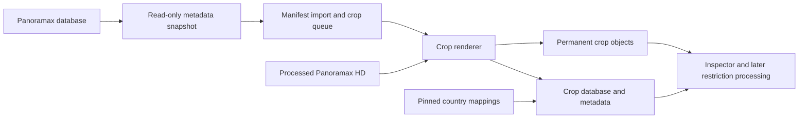

# Panoramax crop database integration

Status: implementation specification, 14 October 2026. The owner requests an
initial import of the existing Panoramax corpus, followed by a nightly import
for the prior day. The confirmed storage scope is **all sign crops and their
metadata, without retaining full images**.

Use a read-only exporter from the Panoramax database on volz-db, produce closed,
checksummed metadata snapshots, and import them into a first-class Panoramax
corpus in the existing private crop database. Generate one downward-expanded
crop for each traffic-sign annotation at the registered image resolution.
Keep the original OSM tags and derive country-specific YOLO class candidates
through versioned reverse mappings. A collection-based API adapter provides a
fallback; the deployed search endpoint alone cannot produce a complete copy.

Backend implementation belongs in `Woladen.de-analytics`. This repository owns
the Inspector changes and shared mapping/geometry fixtures. This specification
does not create a scheduled task or authorize production deployment.

## Copy scope

The permanent copy contains:

- Every current annotation with an `osm|traffic_sign` tag, including `yes`,
  unknown values, ambiguous mappings, supplementary plates, and countries
  without a supported model. Import is independent of class popularity,
  confidence thresholds, mobile collection quotas, and artwork availability.
- A crop for every such annotation with usable geometry and available imagery.
  Each annotation has its own provenance record even when several crops have
  identical bytes or show the same physical sign.
- The source item, collection, annotation, contributor attribution, license,
  geometry, timestamps, camera/EXIF metadata, all semantic tags, source asset
  references, and derived mapping/processing metadata. Mirror the lightweight
  item inventory even for images currently without signs, so later annotations
  can be discovered.
- Current source state at the initial snapshot and subsequent observed
  revisions. Preserve available annotation history, with its source scope.
  Nightly snapshots do not reconstruct every intermediate edit or historical
  object already deleted before the first import.

Full images are read from the existing Panoramax store or downloaded into
bounded temporary processing storage. They are never copied into permanent
crop storage, sync archives, backups, or downstream processing requests. Read
each image once per extraction batch, generate all required crops, verify the
outputs, and release/delete the temporary image. Crash recovery removes
abandoned temporary files within 24 hours. Retries download the source again.

This is a complete **sign-crop corpus**, not a physical clone of the Panoramax
service. Authentication tables, credentials, raw unblurred uploads, thumbnails,
and duplicate full-image storage are outside its scope. A source picture with
only an image-level sign tag and no annotation box receives an explicit
`missing_geometry` record; do not fabricate a sign box or silently omit it.

## Existing integration points

The [Panoramax deployment](../../Woladen.de-analytics/deploy/panoramax/README.md)
places the API, PostGIS, picture worker, and permanent media on volz-db. The
same deployment treats `panoramax.youspeed.de` as an alias of
`panoramax.woladen.de`. Use one logical source identity for both hostnames; do
not import them as separate datasets or crawl the federated global catalog.
Confirm the running host configuration before implementation.

The [crop collection architecture](SIGN_COLLECTION_BALANCING_SPEC_2026-10-12.md)
places private crop storage and PostgreSQL reporting on volz-db, with the
operator frontend served through the existing private reporting boundary.

| Existing component | Integration requirement |
| --- | --- |
| `youspeed.events` and `youspeed.media` | These require phone installation/epoch identity and expiring media. Add external corpus tables and a common inventory view; do not fabricate a phone observation. |
| Mobile crop intake | Its default 5 MiB crop cap and 30-day media expiry are unsuitable for the permanent full copy. Import directly into management storage through a separate corpus importer. |
| Inspector | Extend its list/detail/image adapter to show Panoramax sources alongside mobile crops, including metadata, labels, context geometry, and source links. |
| Live crop-interest planner | Preserve its existing live-source qualification and counts. Report Panoramax inventory separately; importing old imagery must not suppress phone collection. |
| Review and enrichment | Introduce an external-source review policy and explicit downstream eligibility. Existing mobile consent and live-only review predicates cannot qualify external imagery. |

Relevant backend code is in
[management import and cleanup](../../Woladen.de-analytics/commercial_backend/youspeed/management.py),
[media intake](../../Woladen.de-analytics/commercial_backend/youspeed/spool.py),
[live inventory qualification](../../Woladen.de-analytics/commercial_backend/youspeed/crop_interest_inventory.py),
and [crop reviews](../../Woladen.de-analytics/commercial_backend/youspeed/crop_reviews.py).
The current Inspector joins phone media to sightings in
[server.py](../inspector/server.py).



The renderer releases full-image bytes after verification; only crop objects
and metadata enter the retained corpus.

## Source acquisition

### Recommended database exporter

Run a bounded exporter beside Panoramax on volz-db, with a dedicated read-only
database role and access only to processed, blurred imagery. Keep the source
database and destination crop database separate. Do not introduce a public
database listener or cross-database joins in the public web path.

GeoVisio 2.15.1 is the live version observed on 14 October 2026. Its upstream
schema includes `pictures`, `sequences`, `sequences_pictures`, `annotations`,
`annotations_semantics`, `pictures_semantics`, `sequences_semantics`, and
`pictures_semantics_history`. Picture-to-sequence linkage and rank are stored
separately. Use only contributor identifiers/names needed for attribution from
`accounts`. Pin the exporter to the deployed schema and serialization behavior;
introspect the actual migration revision and required columns/functions before
running. These names describe the observed upstream version, not an assertion
that production has no local changes.

Take a `REPEATABLE READ, READ ONLY` transaction and stream a complete metadata
inventory into a new run directory. Include processing status, visibility,
source dimensions/crop metadata, tags, annotation geometry, and the relationships
needed to reconstruct API-equivalent item/collection metadata. Source history
must remain distinguishable from current tags. Finish the export and transaction
before image decoding or destination writes, to avoid holding a database
snapshot during long media work.

Capture a sanitized runtime-configuration snapshot alongside these rows,
including the source license, attribution rules, and canonical/API/media URL
configuration. GeoVisio derives the API item license from
`API_PICTURES_LICENSE_SPDX_ID`, rather than a picture-table column. Preserve
that configuration and its digest in each manifest and metadata fingerprint;
do not export unrelated authentication configuration or secrets.

Each run produces immutable NDJSON parts plus a manifest with schema/exporter
versions, source identity, snapshot time, requested day window, part SHA-256
digests, record counts, and per-item semantic fingerprints. Publish the manifest
by atomic rename only after all parts are complete. The importer consumes only
closed manifests. Fingerprints include annotation membership and tags, picture
metadata/status/visibility, sequence membership and inherited metadata; tag-only
and annotation-removal changes must alter them.

Use native source timestamps to prioritize the previous day's changes, then
compare the complete current metadata inventory with the prior committed
inventory. This comparison is the first-release completeness guard for missed
timestamp updates, source removals, direct metadata edits, and newly ready
images. **Unchanged metadata does not trigger repeated image downloads.**
At larger scale, a durable source change journal can replace frequent full
comparisons only after proving coverage for picture, annotation, tag, sequence,
visibility, asset, and deletion changes. Keep periodic full reconciliation.

Read the source media through the local read-only processed-media mount or
the internal Panoramax gateway. Mount neither unblurred temporary uploads nor
the whole database filesystem into the crop renderer. Record a strong source
asset version/hash when available. If the source store has no immutable asset
version, include asset replacement detection in the adapter qualification:
same-URL content changes must dirty its crops. Filesystem size/mtime and HTTP
ETag are hints unless their strength is established. Strict nightly byte
completeness requires authoritative asset-version signals or, if unavailable,
a nightly local SHA-256 inventory of eligible processed-HD source files.
This streams bytes for verification without retaining a second image copy;
budget its I/O separately from crop rendering. An API-only fallback without
strong asset versions must reread eligible assets for the same guarantee, or
report its weaker eventual asset consistency explicitly.

Database metadata and media files are not one atomic snapshot. Bind each render
to immutable staged image bytes, their SHA-256, and a compatible metadata
revision; compare with the expected asset digest and recheck the source state
around rendering. Mark changed/mismatched inputs stale and retry them through
catch-up. `T0` is a metadata snapshot, not a claim that all crop pixels represent
media bytes at that exact instant without immutable source media versions.

### API fallback

Use the origin instance API, preserving the full item and collection responses.
The live [OpenAPI specification](https://panoramax.youspeed.de/api/docs/specs.json)
advertises the following relevant routes:

| Route | Use and limitation |
| --- | --- |
| `GET /api/collections` | Enumerate collections and follow returned pagination links. Supports collection `created`/`updated` filters and `show_deleted=true`. |
| `GET /api/collections/{id}/items` | Enumerate every item with a bounded `limit`; follow the returned next link using `startAfterRank`. Preserve gaps in ranks. |
| `GET /api/collections/{id}/items/{pictureId}` | Obtain complete item metadata, including its annotation array. |
| `GET /api/annotations/{annotationId}` | Obtain an individual annotation when required; do not assume an annotation-list GET exists. |
| `GET /api/search` | Useful for checks and targeted samples. In 2.15.1 it has a result limit but no pagination or modification-time filter. `datetime` filters capture time. |

For the backfill, enumerate **all** collections and all their item pages, without
a sign-class filter. For nightly work, scan changed collections and their items,
then reconcile against a complete collection/item/annotation inventory. Follow
actual returned links rather than inventing offset/next parameters. Handle
deleted collection entries in their returned representation. Validate the
annotation content of list responses and fetch item details where necessary.

Normal tag edits in upstream 2.15.1 update the parent picture timestamp, and
picture updates propagate to the sequence. This makes changed-collection scans
useful, but is insufficient as the sole completeness guarantee. Item preparation,
out-of-band changes, deletion, and reordering require reconciliation. Restart an
affected collection crawl if its revision changes; deduplicate by picture UUID,
not rank. API crawling has no single transactional snapshot across pages, so a
successful backfill requires a second reconciliation pass. A partial crawl
never establishes absence or authorizes deletion of local records.

### Choice of transport

| Option | Benefit | Cost |
| --- | --- | --- |
| Read-only database exporter with closed manifests | Consistent metadata snapshot, complete enumeration, reliable inventory comparison, efficient local media reads | Version-specific schema adapter and private source privileges |
| Collection-based API adapter | Less coupling to database internals; works remotely | More requests, weaker snapshot consistency, reconciliation needed for updates and deletions |
| Search endpoint only | Convenient discovery | Cannot establish a full copy on the deployed version |

Use the database exporter for the initial and nightly production imports. Keep
API mode for development, independent audits, and fallback when database access
is unavailable. Both adapters emit the same versioned import manifest.

## Crop geometry

Use the existing iPhone/Android downward expansion as the geometry reference:
[iPhone implementation](../iphone/SpeedConsumerApp/SignCollectionCrop.swift) and
[Android implementation](../android/app/src/main/java/de/youspeed/android/alpha/SignCollectionContract.kt).

Panoramax annotations use a top-left pixel coordinate frame. Convert a rectangle
or polygon envelope into integer half-open bounds in the **registered source
image frame**:

```text
left   = floor(min_x)
top    = floor(min_y)
right  = ceil(max_x)
bottom = ceil(max_y)
sign_height = bottom - top

original_box  = [left, top, right, bottom]
requested_box = [left, top, right, bottom + sign_height]
actual_box    = [left, top, right, min(image_height, bottom + sign_height)]
```

Keep the same width and top edge. The crop contains the sign and one additional
sign height **below** it; do not center the doubled box. For a 100 × 80 sign
at `[200,300,300,380]`, request `[200,300,300,460]`, producing a 100 × 160 crop
when the image is tall enough. At an image bottom of 430, store a 100 × 130
crop and `bottom_clipped=true`. Never pad missing context with fabricated pixels.

Validate finite, nonempty geometry and its relation to the registered image
bounds. Preserve malformed/out-of-bounds shapes with `invalid_geometry`; do
not silently correct a sign box into a different object. Expansion beyond the
bottom edge is expected and clipped. Store fractional source geometry,
integer original/requested/actual boxes, requested/actual extra height, and
the sign rectangle relative to the output crop. Preserve polygon geometry
alongside its envelope.

Use the highest available processed, blurred `hd` rendition. Decode once into
the registered raster coordinate frame. Preserve actual raster dimensions,
EXIF orientation, `metadata.crop`/visible-area information, and any explicit
transform. Source EXIF can describe the original capture rather than the
registered asset: never transpose the bitmap alone or infer annotation size
from `properties["pers:interior_orientation"]["sensor_array_dimensions"]`.
With source crop metadata, sensor dimensions can describe the uncropped image.
Any proven rendition scaling/orientation
transform must be applied to both image and geometry and recorded. Prefer HD;
an SD fallback is an explicitly lower-resolution, provisional result that stays
queued for HD replacement.

Tag projection separately. For equirectangular panoramas, preserve native
registered pixels; a seam-crossing annotation needs wrap-aware horizontal
extraction/stitching. If its frame cannot be established, record
`unsupported_geometry` and keep it unresolved. Perspective reprojection is a
different derived variant, not an implicit resize of this crop.

Encode the retained crop as opaque sRGB PNG at native extraction resolution,
without embedded EXIF/GPS/text metadata. Keep all metadata in the database and
sidecar export. Pin the decoder/encoder and record `crop_version=downward-1`
plus renderer version. Use independent server limits and a bounded large-image
worker; do not drop or resize a crop solely to meet phone intake limits.
Resource failures remain retryable and visible.

The extra pixels enable later restriction/supplementary-plate interpretation.
They do not establish that a plate exists or that it applies to the parent sign.
Keep explicitly annotated plates as independent features and retain other
annotation boxes intersecting the crop as context links. Later processing can
add reviewed relationships without rewriting source annotations.

## Country and reverse class mapping

The source key is `osm|traffic_sign`. Preserve its entire semantics array:
Panoramax allows multiple values for a key. Store the original tag string,
parsed national namespace/code, parameters, and compound-group relationships
separately. OSM traffic-sign values can contain comma-associated signs,
semicolon-separated groups, inherited country prefixes, and bracketed values;
use a bracket-aware parser rather than splitting or stripping punctuation.
[Panoramax semantics](https://docs.panoramax.fr/backend/install/deep_dive/semantics/)
and [OSM traffic_sign syntax](https://wiki.openstreetmap.org/wiki/Key:traffic_sign)
define the source formats.

Keep `sign_namespace_country`, `image_geographic_country`, and
`target_classifier_country` as separate fields. A national prefix selects the
code namespace; it does not prove where the image was taken. Resolve geographic
country from source country metadata or a pinned boundary dataset and picture
coordinates, with ambiguity/accuracy retained. For generic labels such as
`maxspeed:50`, require country evidence before deriving a national code. Flag
namespace/GPS disagreement and country ambiguity; never default to DE or infer
jurisdiction from the host or contributor.

### Mapping inputs and compilation

Compile a checksummed relation, not a single-value inverse dictionary, from:

1. The backend's versioned forward maps in
   [`deploy/prolix/class_maps/{country}.json`](../../Woladen.de-analytics/deploy/prolix/class_maps/README.md).
   These are the existing Prolix label-to-national-code relation and record CSV
   corrections, source hashes, and duplicate resolutions. Preserve all inverse
   candidates and mapping revisions emitted in source model metadata.
2. The exact classifier inventories in
   `shared/tsr/prolix-{de,fr,nl,ch,be}-class-catalog-v1.json`, including checkpoint
   hashes, ordered `class_labels`, and explicit `signs[].class_id/sign_code`
   associations. Validate every derived YOLO label/index against its chosen
   country/model inventory. A null sign code is not a mapping, and
   `display_eligible=false` does not exclude a class from import.
3. The [shared Panoramax mapping source](../shared/tsr/sign-pictograms/sources/panoramax-country-code-mapping-v1.json)
   as provenance/comparison input, plus explicit versioned aliases where needed.
   It is not an independently authoritative runtime label inventory.

Namespace unprefixed catalog sign codes with that catalog's country. Combine
compatible forward-map and catalog associations; keep disagreements and missing
aliases explicit. Never derive a class from a translated display label. Known
normalizations, such as an exact `Fr:A8` correction, belong in the artifact
with their source provenance. Never lowercase every code or strip numeric
parameters. Persist the complete mapping hash, model/catalog hash, country,
actual model label, and zero-based class index for each successful association.

The current backend generic FR map and the pinned FR model inventory have
different label vocabularies: the model emits `B14-50`, while the forward map
uses `maxspeed:50`. The current classifier performs a direct label lookup.
Therefore the importer needs an explicit catalog association/adapter; reversing
the generic map does not by itself yield the actual FR YOLO class. This spec
does not change the separate Prolix classifier/publishing runtime.

| Source code | Required mapping behavior |
| --- | --- |
| `DE:274-50` | Resolve `maxspeed:50` only against the pinned DE class inventory; preserve numeric speed 50 and its units. |
| `FR:B14[50]` | The catalog association yields actual FR label `B14-50`. Keep generic semantic candidate `maxspeed:50` distinct from the actual model class. |
| `FR:B33[50]` | Add an explicit versioned association to native `B33-50`, validating inventory membership. Its current catalog sign code is null; preserve the crop as unmapped until that adapter exists. |
| `DE:315` | The forward relation contains multiple parking classes. Preserve candidates; do not select the first. |
| `FR:B21a2` | Preserve the forward relation's conflicting arrow candidates. An actual-model catalog association can be recorded separately with its authority and any remaining semantic ambiguity. |
| `NL:B01` | Preserve the forward map's recorded compatibility resolution. It is not proof that the associated generic label is reviewed truth. |
| `yes`, unsupported codes or countries | Retain crop and tags with an unresolved mapping status. |

Store separate `semantic_candidates` and `yolo_candidates`, with independent
`semantic_mapping_status`, `yolo_mapping_status`, and country-resolution state.
Mapping statuses are
`unique`, `ambiguous`, `unmapped`, `country_unknown`, `country_conflict`,
`unsupported_country`, and `catalog_mismatch`. A unique target class is a
derived association, not evidence that the source annotation is correct.
An independently valid catalog association may select a YOLO class while the
generic semantic inverse remains ambiguous: `FR:B21a2` can select native
`B21a2`, and the reviewed BE catalog maps `BE:C29` to native `maxheight` despite
the backend forward map's different code. Preserve incompatible candidates and
their authority without selecting them. Such disagreement never blocks crop
storage/readiness or a valid independent catalog association.
Multiple sign codes on one annotation produce multiple label rows linked to
one crop; candidate multiplicity must not multiply image objects or counts.

Preserve source detection/classification models, original confidence strings,
and parsed numeric confidence where valid, associated with the exact tag they
qualify. Reverse lookup has no new inference confidence. A catalog upgrade
creates a new mapping revision and can reclassify stored metadata without
downloading full images. Manual reviews and future OCR/LLM outputs are separate
derived records; they never overwrite original tags.

## Destination data model

Add the following management tables under the existing `youspeed` schema.
Names are proposed; migration ownership remains in `Woladen.de-analytics`.

| Table | Key and contents |
| --- | --- |
| `panoramax_sources` | Logical instance identity, canonical URL/aliases, source/exporter/schema versions, permitted visibility scope |
| `panoramax_sync_runs` | Run UUID, mode, local-day and UTC window, snapshot/cursor, manifest digest, phase, counts, retries, exceptions, completion timestamps |
| `panoramax_collections` and `panoramax_items` | Stable source UUIDs, current revision links, status/visibility, contributor/license, capture/created/updated times, location and asset/geometry metadata |
| `panoramax_metadata_revisions` | Immutable raw source JSON and semantic fingerprint, object type/ID, observed time/run, source timestamp, current versus source-history provenance |
| `panoramax_features` | `(source_id, picture_id, annotation_id)`, original shape/tags, current revision, admission/deletion state and processing status |
| `panoramax_crops` | Stable feature/variant identity, source asset digest, renderer/geometry version, original/requested/actual boxes, relative sign geometry, clipping, output dimensions/hash/bytes/object key, generation state |
| `panoramax_class_labels` | Feature/metadata revision, raw and parsed code, countries, candidate/selected class associations, class indices, mapping/catalog/model hashes and resolution state |
| `panoramax_crop_reviews` | External-source review history bound to source revision and crop digest, separate from mobile live-only reviews |

Use source-neutral crop identities in the common inventory. A deterministic
UUIDv5 derived from source + picture + annotation + variant can identify a crop;
store immutable render revisions separately. Render identity includes source
asset digest, rendition identity, normalized annotation geometry/transform
digest, geometry policy version, and renderer version. Tag/mapping-only edits
create label/metadata revisions without duplicating crop pixels. A deleted and
recreated annotation is a new feature with separate provenance.

Store crop bytes by SHA-256, for example
`panoramax/crop-objects/sha256/ab/<digest>.png`, with a unique digest object index.
Exact duplicates share storage but retain every source feature link. All
inventory counts distinguish annotations, logical crops, distinct byte objects,
and label rows. Spatial proximity or matching image bytes does not establish
physical-sign identity.

Add a source-neutral inventory view/list DTO with `source=mobile|panoramax`,
crop identity, capture time, country, raw/derived classes, geometry, provenance,
review state, and source links. Preserve existing phone API responses; add a
Panoramax adapter and source-neutral image resolver. Phone installation is null
for Panoramax, not a generated synthetic device. The Inspector's country view
must distinguish geographic country from classifier country.

## Backfill and nightly execution

Use an external cron/container one-shot schedule at **03:30 Europe/Berlin**.
Compute the previous calendar day's `[00:00, next 00:00)` interval in that
timezone and persist its equivalent UTC boundaries. DST days are 23 or 25 hours;
do not implement a day as an unconditional 86,400 seconds. Keep source capture,
upload/creation, modification, observation, and import times distinct.

"Prior day" selects source creations/changes, not the date the photo was taken.
A photograph captured months ago but uploaded or classified yesterday is
imported tonight. An annotation added tomorrow to an old image is imported on
the next run. Pending image processing is retried until ready, independent of
its original day. No night-time job runs a new detector just to invent source
annotations.

### Initial backfill

1. Freeze the mapping/exporter/renderer versions and source visibility scope.
   Export a complete source metadata snapshot at `T0` and persist its manifest.
2. Import item/collection/annotation metadata idempotently. Queue every current
   sign annotation, regardless of mapping success or confidence. Preserve
   nonready items and missing-geometry cases explicitly.
3. Group extraction work by source image, read processed HD once, create all
   required crops, write objects atomically, verify dimensions and SHA-256, then
   commit crop references. Release full-image bytes immediately.
4. Reconcile all source IDs and render states against the snapshot. Record every
   exception. Backfill completion requires a verified crop for every currently
   renderable sign annotation; an exception report is not a successful full copy.
5. Take a catch-up snapshot after `T0`. Apply additions, changes, removals, and
   newly ready images that occurred while rendering the backfill, then enable
   the nightly schedule. Nightly metadata discovery can run during backfill;
   share the queue and prevent an older revision from replacing a newer one.

### Subsequent runs

Acquire a per-source job lock. Request the previous day's source changes, extend
from the last successful checkpoint to cover missed days, and use a 72-hour
overlap for delayed normal updates. Export/compare the full metadata inventory
as the independent completeness guard; the overlap is not a proof of completeness.

Import revisions, compute source-state differences, and queue only added/changed
render work. Retry outstanding nonready/failed items from earlier days. Tag-only
changes remap labels; geometry/asset changes regenerate crops. Process source
removals and visibility changes from complete authoritative snapshots, then
verify output integrity and publish the run report.

Keep discovery and crop-generation checkpoints separate. A committed metadata
snapshot may enqueue durable work even if rendering is incomplete. Its failures
remain in the queue and coverage report; do not mark the crop window complete
or lose them when advancing discovery. Catch-up runs share the same identities
and may span several bounded invocations.

Expose conceptual commands `backfill`, `sync --day YYYY-MM-DD`, `retry`,
`reconcile`, and `remap --mapping-revision ...`. Require explicit source/date
arguments for manual runs and support metadata-only dry runs. Re-running any
command with the same input must not duplicate crop/provenance rows. These are
implementation interfaces, not commands installed by this specification.

## Failures and source lifecycle

Record `pending_source`, `queued`, `rendering`, `ready`, `retryable_error`,
`invalid_geometry`, `missing_geometry`, `unsupported_geometry`,
`source_removed`, and `blocked_visibility` independently of mapping status.
Retain metadata when rendering fails. Use bounded retries with backoff for
timeouts, 429/5xx, and temporarily unavailable images; honor `Retry-After`.
Use configured concurrency/CPU/disk limits so backfill coexists with Panoramax
processing and management PostgreSQL. Low storage pauses new rendering and
preserves queue/checkpoints; it does not evict the retained corpus.

A source 403/404 is an investigation/reconciliation signal, not immediate proof
of deletion. A failed or incomplete source scan never removes destination data.
Confirmed annotation removal makes its crop inactive for current inventory and
downstream work, preserving allowed history. Confirmed picture deletion,
privacy erasure, or loss of permitted visibility invalidates all derived crops
and invokes the external corpus purge policy, including metadata/exports/backups
as applicable. Retain only the minimal suppression tombstone needed to prevent
reimport. Ordinary superseded render revisions may remain for audit; they are
not counted as current usable crops.

Purge erased source links and their crop/metadata revisions independently of
shared storage. Garbage-collect a byte object only when no permitted retained
reference remains. Image serving always checks the selected source link's
eligibility; a surviving duplicate from another source never exposes erased
provenance or restores a suppressed feature.

Default import scope is all readable, processed sign annotations on the owner
instance. Exporting private source rows does not grant serving or processing
permission: enforce a declared visibility scope through both adapters and every
image/report response. Preserve per-image license and attribution with the crop,
and retain a machine-readable transformation description. Downstream training,
external AI processing, publication, and deletion use their own corpus policy;
copying imagery does not fabricate mobile authorization grants.

Because full images are not retained, a future wider crop or a different geometry
requires the original to remain available in Panoramax. Reclassification and
restriction processing of the retained doubled crop work without that original.
Keep missing-source failures explicit rather than claiming reproducibility from
metadata alone.

## Verification and rollout

Before selecting the source adapter, verify deployed schema/migration revision,
processed-HD coordinate frame, visibility permissions, asset replacement signals,
and behavior of annotation/tag/deletion timestamp propagation. Compare exported
metadata against API responses for a small deterministic sample across countries,
rotations, and panorama types. Overlay the same source annotation landmarks on
decoded HD and SD through their declared transforms before enabling extraction.

Acceptance covers the following:

- Complete enumeration beyond API limits, pagination gaps and sequence reorder;
  same canonical source imported through either hostname yields one corpus.
- Each source sign annotation has metadata and either a verified native crop or
  a visible unresolved reason. Unmapped/generic/unsupported-country signs are
  retained. Group sums do not multiply counts through label joins.
- Pixel tests for fractional bounds, every image edge, doubled height, bottom
  clipping, polygons, registered versus sensor dimensions, EXIF orientation,
  and panorama seams. Shared simple-box fixtures agree with both phone clients.
- Country and class fixtures for all five current catalogs, numeric parameters,
  compound/supplementary codes, ambiguous inverses, FR national labels,
  unsupported codes, country conflict, and mapping/catalog upgrades.
- Same-day replay, missed-night catch-up, a late upload of an old capture,
  delayed classification/readiness, tag-only correction, annotation delete/create,
  asset replacement at the same URL, and DST day boundaries.
- Crash/retry around manifest close, object write, and database commit; corrupt
  bytes, unavailable source, rate limiting, low disk, and incomplete inventory
  never create false readiness or destructive absence decisions.
- No permanent full-image objects or full images in backups; temporary-file
  cleanup works after crashes. Crop objects pass checksum/dimension checks and
  a restore test with their metadata.
- Inspector presents Panoramax provenance and original sign box within its
  context crop. Existing phone gallery behavior and live balancing counts stay
  consistent, including mobile deletion/expiry behavior.

Report per run: source items/collections/sign annotations, additions/changes/
removals, verified current crops, unresolved geometry/source errors, mapping
statuses by country, duplicate objects, bytes written/downloaded, temporary
storage peak, oldest pending work, and last completed crop window. Distinguish
unmapped labels from missing crop bytes. Alert on failed runs, stalled backfill,
coverage gaps, or overdue prior-day processing.

Implement in this order: source adapter and manifest contract; mapping relation
and parity fixtures; external corpus migration/importer/renderer; Inspector
adapter; backfill reconciliation; scheduled sync and operational restore checks.
Size permanent storage from measured crop output bytes and metadata revisions,
not the full-image corpus. Select initial concurrency and capacity after a
bounded sample; no production storage/throughput estimate is established here.

## Source references

- [Live instance configuration](https://panoramax.youspeed.de/api/configuration)
  and [OpenAPI](https://panoramax.youspeed.de/api/docs/specs.json), inspected
  14 October 2026.
- [GeoVisio 2.15.1 item queries and serialization](https://gitlab.com/panoramax/server/api/-/blob/2.15.1/geovisio/web/items.py),
  [semantics and history](https://gitlab.com/panoramax/server/api/-/blob/2.15.1/geovisio/utils/semantics.py),
  and [source schema migrations](https://gitlab.com/panoramax/server/api/-/tree/2.15.1/geovisio/migrations).
- [Panoramax STAC compatibility](https://docs.panoramax.fr/backend/dev/STAC_compatibility/)
  for item assets, processing states, and source metadata semantics.
- [Panoramax deployment](../../Woladen.de-analytics/deploy/panoramax/README.md),
  [Prolix mapping sources](../../Woladen.de-analytics/deploy/prolix/class_maps/README.md),
  and [current classifier](../../Woladen.de-analytics/prolix_pipeline/classifier.py).
- [Mobile crop specification](YOUSPEED_1_4_SPEC.md),
  [collection/planner specification](SIGN_COLLECTION_BALANCING_SPEC_2026-10-12.md),
  and [Inspector](../inspector/README.md).
