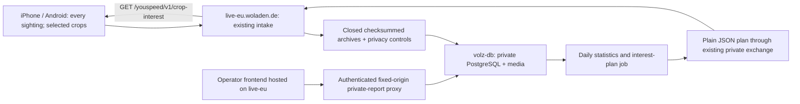

# Sightings and daily balanced crop collection

Owner decisions: 12–13 October 2026, including always-collect `bad`/`bad:*`,
HTTPS-only plan transport and visual-TSR activation requests. Implemented in
both repositories; backend release `d65f09b464` and the daily planner were
activated on volz-db/live-eu, and both phones were updated through build 10046.
The rollout and subsequent drive checks occurred on 13–15 October 2026.
Canonical implementation tracker: [YouSpeed #6](https://github.com/volzinnovation/youspeed.de/issues/6).
Backend implementation and release tracking:
[analytics #9](https://github.com/volzinnovation/Woladen.de-analytics/issues/9).

## Measured problem and counting limits

Read-only PostgreSQL snapshot at **2026-10-12 19:00:35 UTC / 21:00:35 CEST**:
**8,690 stored crops, 157 country/raw-label groups, 123 distinct raw labels**.
The grouped sum equals an independent media-table count in the same
repeatable-read transaction. This is 168 more crops than the earlier 8,522
snapshot today. The raw report includes every stored crop, including replay.

| Model country | Raw crops | Provenance-qualified live rows, active with both grants | Archive/replay rows |
| --- | ---: | ---: | ---: |
| CH | 5,973 | 521 | 5,452 |
| DE | 2,503 | 2,503 | 0 |
| FR | 214 | 214 | 0 |
| Total | 8,690 | 3,238 | 5,452 |

The provenance/lifecycle assessment is a second read-only snapshot at
19:03:13 UTC. All raw rows were joined without multiplication; no missing or
unknown provenance was returned by the pinned backend Python predicate.
The two raw totals agree. **5,452 / 8,690 = 62.74%** of stored crops are
archive/replay. CH's largest raw class has 655 images; its smallest observed
class has one. DE has **302 `bad`, three `bad:windows`, two `bad:round`** crops;
the mandatory bad family totals **307**. Classes absent from the observed rows
are not represented by these min/max figures.

The database contains **4,440 sighting events**, 63 without a currently stored
crop. Absence of a stored crop does not prove why it was omitted or that it was
never sent. Repeated crops belong to the same sighting and are not independent
physical-sign encounters. Country currently means the classifier's model
domain, not independently verified GPS jurisdiction. Labels are predictions,
not reviewed truth. Raw labels such as `Maximum speed 30 km/h` and
`maxspeed:30` must not be merged by string heuristics.

The observed database lacks `youspeed.crop_reviews` and
`youspeed.live_crop_exclusion_reason(jsonb,jsonb)` at assessment time. The
3,238 figure is **source/lifecycle/positive-consent qualified only**: image
bytes, label truth and physical-sign deduplication were not validated. It must
not be presented as a training-ready or planner-ready population.

The raw CSV, snapshot, provenance assessment and assessment code are retained
locally under `docs/collection-evidence/2026-10-12/`; drive evidence is excluded
from this public repository. The maintained report command is
[`scripts/inspector/sign_statistics.py`](../scripts/inspector/sign_statistics.py).

## Product behavior

A **sighting** is one consolidated device observation of a sign at a capture
time, with location and uncertainty when available. Keep the existing
two-frame/100 ms qualification, immutable observation ID, session/epoch,
model provenance, raw classification, geometry and available GPS/road context.
Missing location remains explicit; do not invent a position or physical-sign
identity. With existing sign-sharing authorization, every qualifying sighting
and correction is queued independently of crop interest.

A **crop** is optional image evidence linked to that sighting. An ordinary
class outside the current interest plan still creates and uploads a sighting,
with empty initial `media_refs`, but creates no contribution crop file and
sends no contribution image bytes. For a selected encounter, retain the
existing exact-frame crop selection: six regular samples, two reserved for
at least 1.5× sign-area growth, 500 ms spacing, at most eight successful crops,
and at most four capture attempts per processed frame. No new inference is
required for interest selection.

**Always collect `bad` and anchored `bad:*` classes.** This invariant applies
in every model country, even when normal-class targets are met, the plan is
empty, startup is offline, or the plan is missing, malformed, incompatible or
expired. It overrides daily balancing probabilities and class budgets. Match
an exact raw class identifier from the activated, verified model/catalog:
`label == "bad" || label.startsWith("bad:")`. Never search UUIDs, free text or
human display labels. Existing sharing consent, withdrawal/deletion barriers,
frame/encounter caps, thermal/storage/network limits still apply. “Always”
means always eligible within these bounds, not guaranteed lossless delivery.
Bad-family image/byte load is reported separately from the normal-class budget.

This supersedes **unconditional crop creation for every ordinary class** once
implemented. Every crop actually selected and created still uses the existing
best-effort-v2 upload: one POST, empty 204 sufficient, at most three attempts,
bounded queues, 100-event batches and existing request limits. Introduce no
reservations, per-crop permission round trip, receipt polling or camera-idle /
Wi-Fi gate. Panoramax still capture/upload, recognition, driver display,
applicability and the locked speed-reference policy are unchanged.

## Architecture and ownership

`Woladen.de-analytics` owns shared backend contracts, migrations, planner,
plan exchange, API serving and deployment scripts. `youspeed.de` owns both
phone clients and Inspector frontend source. Frontend assets and the
app-facing API are hosted on **live-eu.woladen.de**; private reporting,
planning, database and crop storage remain on **volz-db**. Do not duplicate
backend runtime code in an app/frontend repo. No new public volz-db listener,
direct live-to-management SQL query or live-spool mount by the planner.

The operator frontend on live-eu requires existing authenticated access to a
fixed private report proxy. Never place report/review credentials or a shared
operator token in browser assets, public plans or URLs. Only the small common
interest policy is anonymously readable; private inventory and crop images
retain their existing access boundary.

## Stable class identity and planner input

Enumerate every supported class, including zero-count classes, from the
versioned classifier catalogs. Define a collection key by **model country +
catalog class ID**, and explicit compatible mappings from **pack manifest
SHA-256 + raw model label/class ID** to that key. Current `pack_version`
contains a manifest-schema version and is not a model release identifier;
use actual pack/component hashes. Do not merge classes or pack revisions
without an approved compatibility mapping. Preserve numeric values, class
families and country distinctions. The plan explicitly identifies the
registry/mapping revision and applicable pack hashes.

`classification.model_label` is a compatibility field name whose value must be
the raw classifier/catalog **class ID**, such as `maxspeed:30`, never display copy
such as `Maximum speed 30 km/h`. Both apps and replay uploads emit IDs. Management
normalizes legacy labels using exact country, pack and classifier provenance,
and stores only resolved class IDs. Statistics group by country and class ID;
human-readable names are presentation metadata, and national `canonical_code`
values are separate from classifier IDs.

The planner's retained usable-crop count `U[c]` excludes archive/replay,
simulated installations, unknown/mismatched provenance, expired/withdrawn/
tombstoned sources and missing/corrupt image objects. Enforce positive current
metadata and crop-storage grants, source linkage using the currently recorded
consent/deletion state. Use the shared live-source predicate and background integrity
verification; do not add image hashing or qualification to the live upload path.
When any required migration/grant/mapping/integrity index is missing,
withhold a new qualified plan and surface the reason; do not substitute the raw
report and call it eligible data.

Deduplicate exact image digests within each class and report both crop counts
and distinct `(installation, epoch, observation_id)` encounter counts. Track
same-source/session/site diversity separately; these identifiers do not prove
physical-sign uniqueness. Latest source-bound class reviews may reassign an
image to a corrected class without overwriting its original prediction; exclude
`not_a_sign`/`uncertain` from ordinary positive-class targets. Keep unreviewed
but source/image-verified samples visibly **provisional**, with an explicit
bootstrap allowance instead of silently claiming reviewed truth. Always-bad
capture does not depend on such review.

## Daily target and selection algorithm

Owner revision, 13 October 2026: production uses `daily-maximum-v1`. This
supersedes the draft fixed targets, water filling, budgets and hash sampling.

Run the bounded one-shot management job on volz-db once per UTC day at 00:15
UTC using cron, after archive import and image-integrity work. Take one
repeatable-read snapshot; failed/overlapping runs retain the prior revision.
A successful retry may publish a higher revision on the same day.

1. Pool supported ordinary classes across all enabled countries. Keep zero-count
   classes and exclude exact `bad` and `bad:*` from this calculation.
2. Let `M = max(U[c])`, the greatest usable ordinary-class crop count.
3. If `M > 0`, request every class with `U[c] < M`, with deficit `M - U[c]`.
   Classes tied at the maximum are not requested.
4. If every ordinary count is zero, request every supported ordinary class.
5. Every requested class has selection fraction one. There is no crop-interest
   cryptographic hash, signature, key pin or custom encryption. Existing model
   artifact IDs remain opaque exact-match identifiers.
6. Always accept `bad` and any future `bad:*` independently of the list, cache,
   class count or plan availability, subject to existing consent/resource limits.

This balances retained crops approximately. Daily snapshots, repeated crops,
concurrent devices, offline queues and archive lag may overshoot the maximum;
rare signs still depend on actual encounters. Preserve authorized queued crops
and their original selection revision when a newer list is generated.

## Startup API and plan lifecycle

GET `https://live-eu.woladen.de/youspeed/v1/crop-interest` returns common bounded
plain JSON. Standard HTTPS is the only crop-plan transport protection. There
are no application signatures, verification keys, purpose envelope or content
hash. ETag is `"crop-interest-{revision}"`, with If-None-Match and 304 support.
A missing/invalid/expired local plan returns 503 plus Retry-After; a valid empty
ordinary list returns 200 and does not enable every ordinary class.

| Field | Meaning |
| --- | --- |
| `schema_version`, `revision`, `algorithm_version` | Contract, monotonic revision and `daily-maximum-v1` |
| `generated_at`, `valid_from`, `valid_until` | UTC validity, maximum 48 hours |
| `daily_maximum`, `bootstrap` | Pooled usable-class maximum and all-empty bootstrap |
| `registry_revision`, `compatible_packs` | Mapping revision and existing exact pack identifiers |
| `always` | Fixed exact `bad` and anchored `bad:` prefix |
| `interests[]` | Collection key, country/class, exact country/pack/classifier/raw-label selectors, fraction one, deficit and encounter bounds |
| `limits` | Existing request/image bounds |

The existing authenticated infrastructure exchange moves this plain plan from
volz-db to live-eu. It adds no plan cryptography. Validate schema, exact mappings,
UTC validity and revision before atomic installation. Equal revisions must have
equal document contents; expired caches retain the revision floor. Rollback
means publishing a higher revision containing the prior policy. Public serving
reads the local file and never queries private management PostgreSQL.

**Mobile request rule:** only when the camera-based/visual TSR option is enabled.
At app startup, make one asynchronous request if it is already enabled. Otherwise
make none. Also request when the option changes from disabled to enabled.
Repeated foreground/resume events, camera restarts, model reloads, network
changes, day rollover and upload timers do not refetch. One app session means one
app-process lifetime; a later false-to-true setting transition is another allowed
request. There are no automatic retries within that activation; server
Retry-After does not create a background polling loop.

Recognition, sightings and driving never wait for the request. Cache a valid
response atomically until expiry. Failed requests retain a usable cache. Missing,
invalid, incompatible or expired plans allow every sighting and the bad family;
ordinary crops wait for a valid plan at the next permitted request. Disabling
visual TSR cancels an in-flight request. Reject future validity and wall-clock
jumps. GET sends no installation/device/location identifiers or contributor tokens.

## Mobile integration and observability

Apply the plan before frame conversion, crop encoding, file storage and upload.
On iPhone, gate `SignCollectionCoordinator` before its lazy `frame.image()` call.
On Android, gate the coordinator before `frame.crop()` and make
`AndroidTrafficSignRuntime.wantsCropFrame` class-aware before copying the full
upright bitmap. Interest changes do not consume a crop slot or cause a sighting
to be lost. Snapshot the plan/class selection when the sighting qualifies; pause new
ordinary crop work on expiry, while keeping the sighting and always-bad rule.
Do not delete existing authorized queues on routine plan refresh.

Android has two gates: class/plan eligibility before the bitmap copy, then the
optional noncryptographic UUID draw before crop encoding. The UUID is created inside the
observer, after runtime copying; do not claim that the first gate can already
apply the encounter draw. An eligible-class frame that later samples out may
still incur that copy until a separately measured optimization is implemented.

Extend shared evidence additively with optional selection provenance: plan
revision, collection key, decision (`always`, `selected`, `not_interested`,
`sampled_out`, `no_valid_plan`) and applicable sampling fraction. Bind each
selected crop to its sighting and captured revision. Never repurpose
`media_refs:[]` to mean “not interested”; missing images and unselected images
are different reasons. Backend schemas ship before clients emitting new fields.

Private daily operator views on live-eu display raw/live/replay/unknown,
provisional/reviewed, usable images/encounters, zero-count classes, deficits,
interesting/always classes, selected versus skipped sightings, crop bytes,
plan age, HTTPS/mapping state, import/control lag and scheduler outcome.
Rare/unreachable classes and byte/resource-induced drops remain explicit.
Balanced crop collection is not a measurement of road prevalence or missed-sign recall.

## Implementation sequence and acceptance

1. Backend on volz-db: verify migrations/grants and control freshness; implement
   registry mapping, integrity-aware inventory, planner tests and daily job.
2. Shared contracts and reverse plain-plan exchange; live-eu GET API and authenticated
   operator frontend. Build every backend host/container from the same immutable
   runtime revision; deploy data plans independently, preserve volumes and static
   map/model bundle identities. Stage restart/health/rollback and existing Woladen
   API regression checks before any approved deployment.
3. Backend accepts additive selection provenance before iPhone/Android activate
   matching plan clients. Canary both platforms, then enable normal-class gating.
4. Verify one complete daily cycle and rollover, restart/reboot, delayed import,
   failed generation, malformed plan, stale/expired cache, offline
   first launch, and a rollback published as a higher plan revision.

Acceptance requirements:

- Identical qualifying fixtures preserve sighting counts and within-device
  encounter IDs whether all, some or no ordinary classes are selected. Real
  devices generate independent UUIDs; cross-platform sampling fixtures inject
  the same UUIDs explicitly. Uninterested
  classes perform zero contribution encoding/storage/upload and Android frame-copy
  work when no interested detection is present.
- `bad`, `bad:round`, `bad:windows` and any future `bad:*` subclass are always
  eligible, including absent/expired plans and ordinary classes at the daily maximum. A UUID
  containing `bad`, `notbad`, `badger` or an arbitrary display label is not.
- Privacy/epoch/delete and global bounds override every crop decision; metadata
  and corrections remain independent of crop selection/failure.
- Exact country/catalog/model selection, zero-count classes, reviewed corrections,
  replay exclusion, schema/readiness failure and publication despite delayed controls are tested.
- Ordinary per-encounter sampling/cadence, model changes and refresh races match
  across Swift/Kotlin shared vectors; real iPhone/Android device workloads verify
  that recognition/recording and network settings remain unchanged.
- Daily artifacts reconcile to their declared snapshot, exclude bad from normal
  allocation, and request every ordinary class below the daily maximum. Actual overshoot remains
  observable instead of being described as a strict quota guarantee.
- Public GET contains no private evidence; private frontend access is authenticated;
  live-eu serves validated local documents with no management database dependency.

## Existing ticket integration

| Existing issue | New responsibility |
| --- | --- |
| YouSpeed #6 | Canonical product specification, native selection, always-bad invariant and cross-repo rollout coordination |
| YouSpeed #27 | Exact raw/eligible class counts, review separation, daily interest/always visibility in the Inspector frontend hosted on live-eu |
| YouSpeed #28 | Crop-to-sighting/source linkage and diversity/grouping inputs, independent from exact class and exit applicability |
| YouSpeed #10 | Balanced corpus acceptance, zero-count/rare-class shortfalls, repeat-image/site grouping and unbiased metadata/recall caveats |
| analytics #9 | Planner/API/exchange/contracts, UTC cron, volz-db management versus live-eu serving boundary and immutable coordinated deployment |
| analytics #13 | Daily refresh/expiry/lag alarms, runbooks, parity canary and rollback acceptance |

YouSpeed #2 and analytics #22 are already closed foundation tickets; keep their
completed state and reference them as implementation context, rather than
reopening unrelated completed work. Do not create duplicate tickets.

Source anchors: `SignCollectionObserver`/`SignCollectionCoordinator` in both
apps, `AndroidTrafficSignRuntime`, `shared/tsr/collection-upload-v2.md`,
`docs/SIGN_COLLECTION_REPEAT_CROPS_2026-10-06.md`; sister repo
`commercial_backend/youspeed/{api,crop_analysis,exchange,exchange_api,artifacts,contracts}.py`,
`docs/youspeed/{COLLECTION_UPLOAD_V2,APP_INTEGRATION,CROP_REVIEWS,DEPLOYMENT_PREPARATION}.md`,
and `deploy/onboarded-ingest/youspeed.cron.example`.

## Implementation amendment (13 October 2026)

Swift and Kotlin implement the HTTPS startup request, atomic bounded cache,
revision/expiry checks, exact selectors, stable sighting/crop selection provenance
and bad-family fallback. Existing sighting, correction, consent, deletion and
6+2 crop cadence remain independent. The imported shared schemas come from the
analytics working tree. Backend generation and local serving require no plan
signing key; the historical `content_sha256` SQL column is preserved for existing
rows and stores `revision:{revision}` for new plans. No destructive migration is
needed. Historical signed fixtures remain archived compatibility evidence and
are not consumed by the new plan clients.

## Owner correction: no privacy-stream publishing gate

Daily class-list generation does not wait for an external consent/deletion
sequence watermark, a fresh control-stream timestamp or an import-lag threshold.
It balances the currently stored eligible crops from one database snapshot.
Existing upload consent, source exclusion and deletion processing remain in
their existing paths. The public startup plan omits privacy-control counters;
optional counters on historical plans are diagnostic only and never gate mobile
selection. Delayed imports can affect aggregate counts until the next run,
without blocking the list. Both clients consume this corrected contract.
