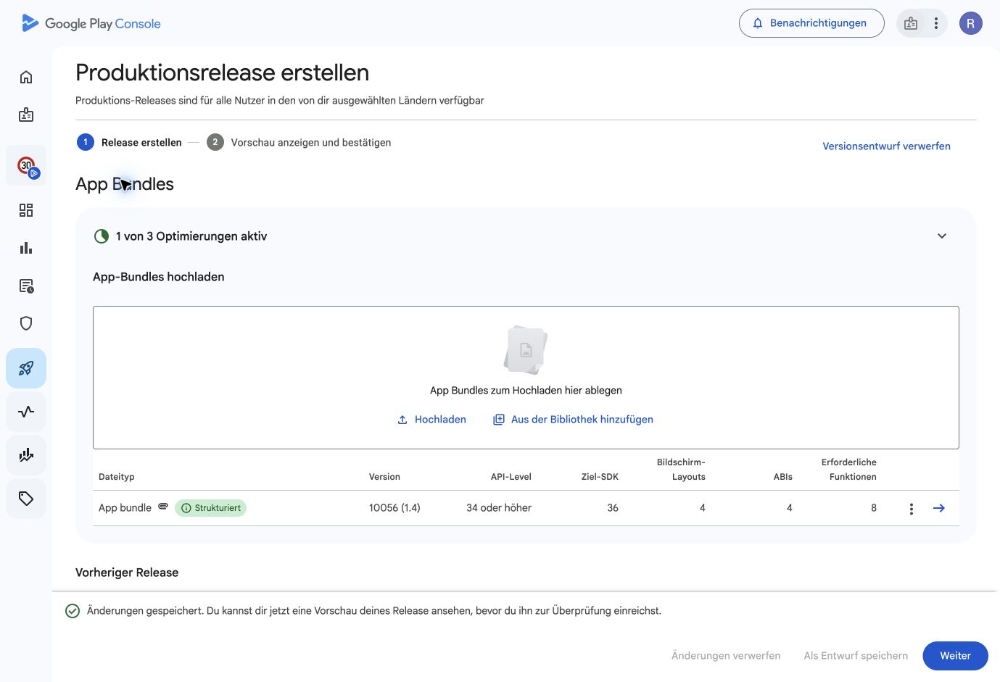
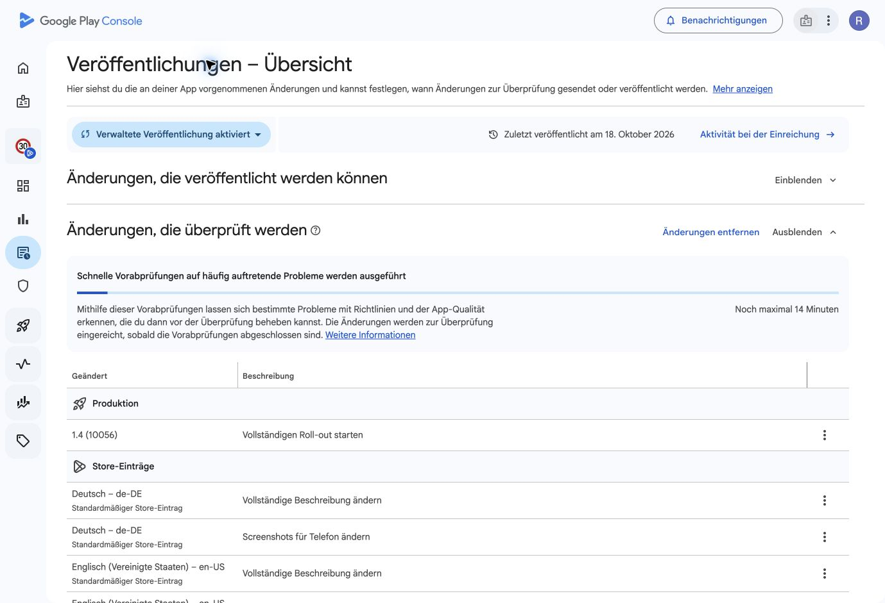

# YouSpeed 1.4 store submission — 21 October 2026

Apple **1.4 (10056)** was submitted for App Review on **21 October 2026 at
14:59:11 UTC** and independently verified as `WAITING_FOR_REVIEW`. Apple validated
the signed IPA and processed it as `VALID`. Release remains `MANUAL`; the version
was not published. Review submission ID: `70230301-d02d-4096-843c-285cc4f92e37`.

Google Play **1.4 (10056)**, production release 3, was sent through the review
submission flow with **19 changes**: the release, nine full descriptions and nine
phone screenshot galleries. At 15:01 UTC, the console displayed “Änderungen, die
überprüft werden” with automatic pre-review checks running; it states that the
changes proceed to review after those checks finish. **Managed publishing is
enabled**, so approved changes remain held until an explicit publication action.
No publication was performed. Play reported one nonblocking warning: native debug
symbols were not uploaded.

Release notes cover all nine listing languages. All nine saved listings were
reopened and verified against the prepared title, short description, full
description and six-image gallery order: **54 screenshots** in total. The signed
Android bundle uploaded through the original Chrome window and completed Play
processing. Build 10033 is excluded from the new release.

Apple's four languages are DE/EN/FR/NL. Prepared version and app-information
metadata were verified through independent API reads; reviewer instructions now
describe 1.4. All **24 Apple screenshots** were already present and have complete
delivery states, matching local MD5 values and the prepared order. Existing
privacy URLs and release settings were retained.

## Build and validation evidence

- Apple source: `bf1f3bb5bd7e2dd842af841f3fc9d6cee2d1a505`. The existing Apple
  Distribution identity and existing store provisioning profile signed the IPA
  at export; no provisioning changes were made. `codesign --verify --deep
  --strict` and Apple's validation passed. Archive and IPA credential-key checks
  passed.
- Android build source: `b1af7751cb8ebd091e94c1667727a942138e80a9`, on the isolated
  `codex/store-1.4-10056` preparation branch. The
  [signed build](https://github.com/volzinnovation/youspeed.de/actions/runs/39616850329)
  uses the existing verified Play upload certificate. No branch was merged.
- The first CI failure exposed a macOS-only test-output path. The contract test
  now uses a portable temporary directory with an explicit output-root override;
  the documented cross-language verification command supplies that override.
- Release lint then exposed Kotlin's interpretation of two solar-declination
  continuation lines as separate expressions. Parentheses now preserve all
  terms, matching the unchanged iPhone implementation. Three numerical
  elevations computed by that Swift source and a sunset-boundary regression
  verify the correction. This changes Android's solar calculation near sunset;
  it does not change the protected speed-limit-reference policy or interpreters.
- Local Android Release unit tests: **742 tests, zero failures/errors, one
  skipped**. Release lint passed. Store-package validation: **186 files, zero
  errors**. The shared release workflow now uses version-neutral artifact names
  and retains its release-test XML reports.
- The signed CI run passed, and its downloaded hashes, AAB signature, existing
  upload certificate, package, version and release-test XML results were
  independently verified. Packaged 64-bit LOAD alignment passed the 16 KB check;
  the audit's conservative RELRO check did not pass, and 16 KB runtime acceptance
  was not tested in this task. The artifact receipt preserves those limits.

The [machine-readable receipt](BUILD_10056_STORE_DRAFTS_2026-10-21.json) records
identities, hashes, source revisions, gallery checks and final store states.
Private build and API evidence remains outside Git under
`/private/tmp/youspeed-store-1.4-10056-2026-10-21/`. The prepared metadata ZIP is
there as `YouSpeed-1.4-store-metadata-2026-10-21.zip`; it excludes app binaries,
credentials and private device evidence.

The store links are [Apple 1.4](https://appstoreconnect.apple.com/apps/6787469256/distribution/ios/version/inflight)
and [Google Play release 3](https://play.google.com/console/u/0/developers/5138521418106883804/app/4974352973939108666/tracks/4697360213117564323/releases/3/prepare).

## External TestFlight — build 10056

Build **1.4 (10056)** was assigned to the existing **Beta-Ext** public group
and submitted for external beta review on 21 October 2026. Apple initially
returned `WAITING_FOR_REVIEW` and approved the beta immediately afterward.
Independent API reads at **2026-10-21T15:24:49.498587+00:00** verified
`APPROVED`, external state `IN_BETA_TESTING`, and build membership in Beta-Ext.
The build is available to external testers through the
[existing public invitation](https://testflight.apple.com/join/k3a1pgce).

German test instructions and 10056 reviewer notes were saved and verified.
Automatic beta notifications remain enabled; the public link, 100-tester limit
and all group settings were retained. The App Store production version remains
`WAITING_FOR_REVIEW` with `MANUAL` release. No production publication was made.
